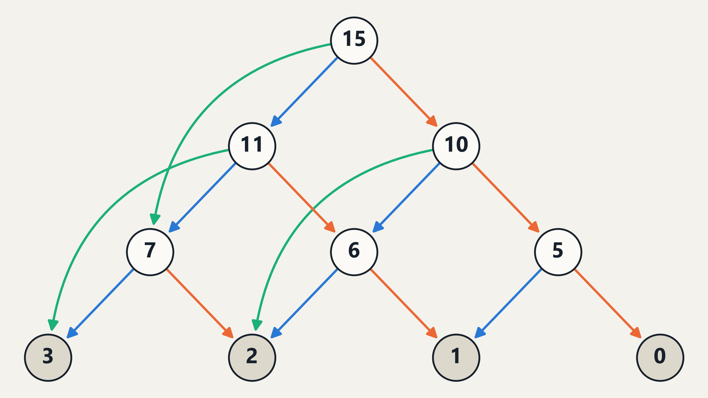

# SC2001 Project 3: Unbounded Knapsack by Dynamic Programming

Team 3 · Gao Ruofei · Gao Xinyu · Ivan Tey Yi Kai

A knapsack has capacity C. There are n types of objects; an object of type i has weight w<sub>i</sub> and profit p<sub>i</sub>, and every type has an unlimited supply. P(C) is the largest total profit of objects whose total weight is at most C. The questions are in [Project3_26S1.pdf](Project3_26S1.pdf).

## Files

| File | Contents |
|---|---|
| [knapsack.cpp](knapsack.cpp) | The whole C++ program: the bottom-up DP, the instances of questions (2) and (4), the correctness test and the timing experiments |
| [plot.py](plot.py) | Draws the figures from the CSV files and prints the fitted lines |
| [results/output.txt](results/output.txt) | Output of `knapsack.cpp` |
| `results/*.csv` | Measured running times |
| [results/fit.txt](results/fit.txt) | Output of `plot.py` |
| `figures/` | The subproblem graph of P(15) and the three timing plots |

## How to run

```
g++ -std=c++17 -O2 knapsack.cpp -o knapsack
./knapsack > results/output.txt        (about 20 seconds)
python plot.py > results/fit.txt       (needs numpy, pandas and matplotlib)
```

- The times in `results/` were measured on an Intel Core i5-12500H (Windows 11, g++ 14.2, `-O2`). The program was pinned to one performance core: `start /wait /b /affinity 1 /high "" knapsack.exe > results\output.txt` in cmd. Without that, Windows sometimes moves the program to an efficiency core, which is about twice as slow.
- In Git Bash, `knapsack.exe` may fail to start, because Git's own `libstdc++` DLL comes first on the PATH. Run it from PowerShell or cmd, or compile with `-static`.

## Answers

**(1) Recursive definition.** Take a best packing for capacity C and one object in it, of type i. The other objects fit in C − w<sub>i</sub>, and they must be a best packing for C − w<sub>i</sub>; otherwise a better one plus the type-i object would beat P(C). So

```
P(C) = 0                                         if w[i] > C for every type i
P(C) = max { p[i] + P(C - w[i]) : w[i] <= C }    otherwise
```

**(2) Subproblem graph of P(15)** with w = (4, 5, 8). An edge c → c − w<sub>i</sub> means that P(c) needs P(c − w<sub>i</sub>). There are 10 subproblems and 15 edges. The base cases are 3, 2, 1 and 0. Capacities 4, 8, 9, 12, 13 and 14 are not needed.



Blue edges subtract 4 (type 0), orange edges 5 (type 1) and green edges 8 (type 2).

**(3) Bottom-up algorithm.** Every edge goes to a smaller capacity, so the algorithm solves c = 0, 1, …, C in this order and stores each answer in a table:

```
P[0] = 0
for c = 1 to C
    best = 0
    for i = 0 to n - 1
        if w[i] <= c
            best = max(best, p[i] + P[c - w[i]])
    P[c] = best
return P[C]
```

It takes Θ(nC) time and Θ(C) space.

**(4) Running results** (from [results/output.txt](results/output.txt)):

| | Instance | P(C) | Packing |
|---|---|---|---|
| (4a) | C = 16, w = (4, 5, 8), p = (7, 6, 9) | **28** | 4 × type 0, weight 16 |
| (4b) | C = 12, w = (5, 6, 7), p = (7, 6, 9) | **16** | 1 × type 0 + 1 × type 2, weight 12 |

## Experiments

1. **Correctness.** On 10,000 random instances (n ≤ 5, w ≤ 12, p ≤ 20, C ≤ 40), P(C) equals the brute-force answer, and the packing found fits and is worth P(C): 0 wrong.
2. **Time against C** (n = 100, C = 100,000 to 1,000,000): a straight line, 5.78 ms per 100,000 of C, R² = 0.9998.
3. **Time against n** (C = 100,000, n = 100 to 1000): a straight line, 4.75 ms per 100 types, R² = 0.9996.
4. **Plain recursion against the DP** (w = 4, 5, 8; C = 40 to 100). The recursion's time grows by ×1.228 per unit of C; theory says ×1.226. At C = 100 it makes 738,787,505 calls and takes 2.4 s. The DP takes 0.26 µs.
