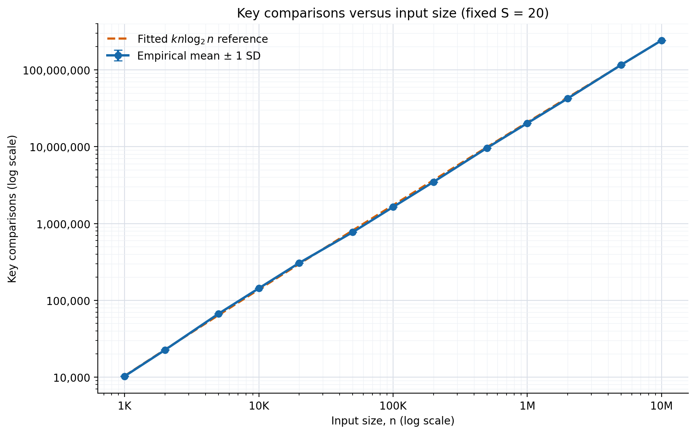
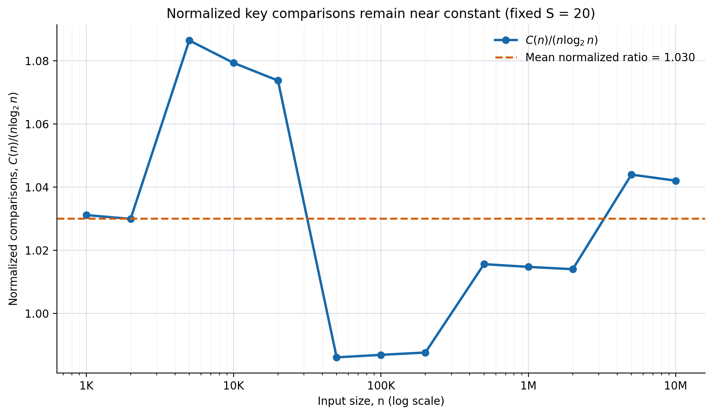

# Part (c)(i): key comparisons versus input size

## Question and experiment design

Part (c)(i) asks how the number of key comparisons changes with input size
`n` when the Hybrid Merge Sort threshold is fixed.

The experiment used:

- fixed threshold `S = 20`;
- `n = 1,000; 2,000; 5,000; 10,000; 20,000; 50,000; 100,000;`
  `200,000; 500,000; 1,000,000; 2,000,000; 5,000,000; 10,000,000`;
- random values in `[1, 10,000,000]`;
- seeds `2001` through `2005` for five reproducible trials per input size;
- Git commit `50d24f1c4ca42f11efa6c44481da7ca4ab63a701`.

Only comparisons between sorting keys were counted. Index checks, loop-bound
checks, and the threshold check `size <= S` were excluded.

## Processing method

For each input size, let `C_i(n)` be the number of key comparisons in trial
`i`. The plotted empirical value is the arithmetic mean over the five seeds:

```text
mean C(n) = (C_1(n) + C_2(n) + ... + C_5(n)) / 5
```

The error bars show one sample standard deviation. The normalization used to
compare the measurements with the theoretical growth rate is:

```text
R(n) = mean C(n) / (n log2(n))
```

If `mean C(n)` grows proportionally to `n log2(n)`, then `R(n)` should remain
approximately constant as `n` increases.

## Results

| n | Mean key comparisons | Sample SD | C(n) / n | C(n) / (n log2 n) | Mean CPU time (s) |
| ---: | ---: | ---: | ---: | ---: | ---: |
| 1,000 | 10,276.0 | 96.52 | 10.276 | 1.031 | 0.0000554 |
| 2,000 | 22,587.8 | 86.91 | 11.294 | 1.030 | 0.0001048 |
| 5,000 | 66,752.4 | 245.53 | 13.350 | 1.086 | 0.0002534 |
| 10,000 | 143,421.8 | 384.59 | 14.342 | 1.079 | 0.0005270 |
| 20,000 | 306,833.8 | 529.64 | 15.342 | 1.074 | 0.0011300 |
| 50,000 | 769,573.0 | 476.98 | 15.391 | 0.986 | 0.0031666 |
| 100,000 | 1,639,078.4 | 298.87 | 16.391 | 0.987 | 0.0064918 |
| 200,000 | 3,478,097.0 | 672.39 | 17.390 | 0.988 | 0.0135974 |
| 500,000 | 9,613,191.6 | 2,230.89 | 19.226 | 1.016 | 0.0343662 |
| 1,000,000 | 20,224,606.6 | 2,305.64 | 20.225 | 1.015 | 0.0732060 |
| 2,000,000 | 42,448,125.8 | 2,634.23 | 21.224 | 1.014 | 0.1483674 |
| 5,000,000 | 116,158,184.0 | 5,382.85 | 23.232 | 1.044 | 0.3933506 |
| 10,000,000 | 242,310,784.6 | 6,457.33 | 24.231 | 1.042 | 0.8151354 |





The mean comparison count rose from `10,276.0` at `n = 1,000` to
`242,310,784.6` at `n = 10,000,000`. Comparisons per element also increased
from about `10.276` to `24.231`, so the measured growth is not linear.

The normalized ratio `C(n) / (n log2 n)` stayed between approximately `0.986`
and `1.086`. Its stability over four orders of magnitude in `n` supports an
`n log n` growth model.

## Theoretical reasoning

The Hybrid Merge Sort recursion stops when a subarray has at most `S`
elements.

### Merge work

Stopping at subarray size `S` gives approximately:

```text
log2(n / S)
```

merge levels. Each level processes a total of `Theta(n)` elements, so the
merge work is:

```text
Theta(n log2(n / S))
```

### Insertion Sort work

There are approximately `n / S` leaf subarrays. Insertion Sort requires
`O(S^2)` comparisons on one leaf in the general case, giving total leaf work:

```text
(n / S) * O(S^2) = O(nS)
```

### Combined bound

Combining the two components gives:

```text
T(n, S) = Theta(n log2(n / S)) + O(nS)
```

For this experiment, `S = 20` is fixed. Therefore `log2(S)` and `S` are
constants:

```text
n log2(n / S) = n(log2(n) - log2(S)) = Theta(n log n)
O(nS) = O(n)
```

The overall asymptotic behavior is consequently:

```text
T(n) = Theta(n log n) for fixed S
```

Hybridization changes constant factors and practical overhead, but it does not
change the asymptotic large-`n` behavior when `S` is fixed.

## Interpretation and limitations

- The empirical curve closely follows a scaled `n log2(n)` reference.
- The nearly constant normalized ratio gives stronger evidence than observing
  only that the raw count increases.
- The small standard deviations show that key-comparison counts are stable
  across the five seeded random inputs, especially at larger `n`.
- CPU time is included as supporting information, but Part (c)(i) specifically
  asks for key comparisons. Very short timings at small `n` are more sensitive
  to timer resolution and system activity.
- The experiment supports the predicted growth rate; finite measurements do
  not constitute a mathematical proof of an asymptotic bound.

## Report-ready paragraph

With the threshold fixed at `S = 20`, the mean number of key comparisons
increased from `10,276.0` for `n = 1,000` to approximately `242.3 million` for
`n = 10,000,000`. The empirical curve closely followed a scaled
`n log2(n)` reference. In addition, the normalized ratio
`C(n) / (n log2(n))` remained between approximately `0.986` and `1.086` across
the tested input sizes. This is consistent with the theoretical analysis:
the merge levels contribute `Theta(n log(n/S))` work, while the Insertion Sort
leaves contribute `O(nS)` work. Since `S` is fixed, these terms simplify to an
overall complexity of `Theta(n log n)`. Thus, the hybrid threshold changes
constant factors and practical overhead without changing the asymptotic growth
rate with respect to `n`.

## Presentation summary

- Fix `S = 20`; use 13 input sizes from `1,000` to `10,000,000`.
- Use five reproducible random inputs per `n` and plot the mean comparison
  count with one-standard-deviation error bars.
- Observe comparison counts rising from about `10.3 thousand` to
  `242.3 million`.
- Show that `C(n) / (n log2 n)` stays near `1`, supporting
  `Theta(n log n)` growth.
- Conclude that fixed-`S` hybridization changes constants, not the asymptotic
  order.
