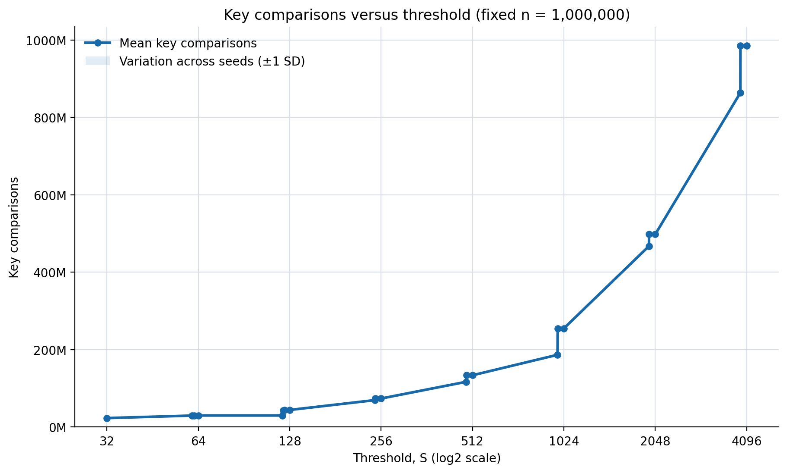
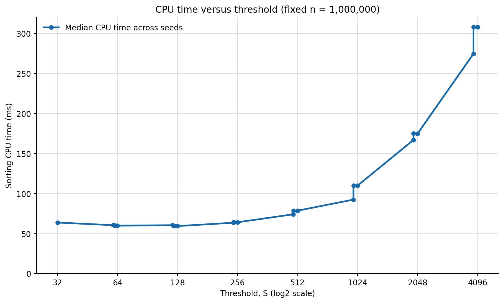
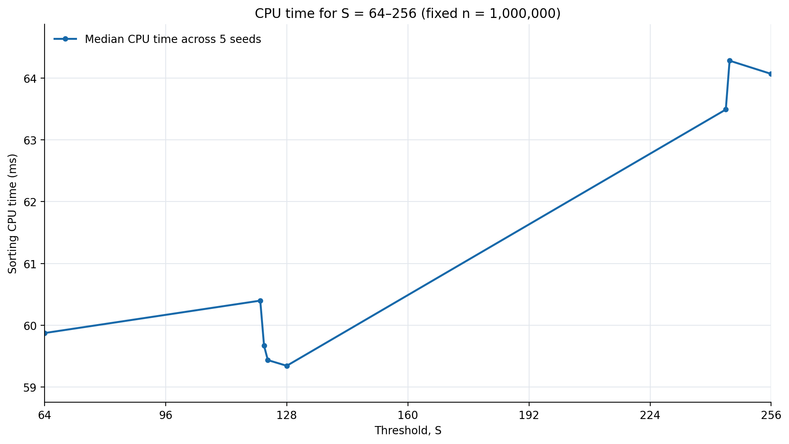
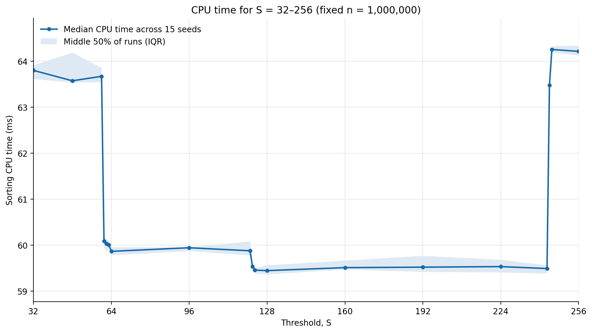
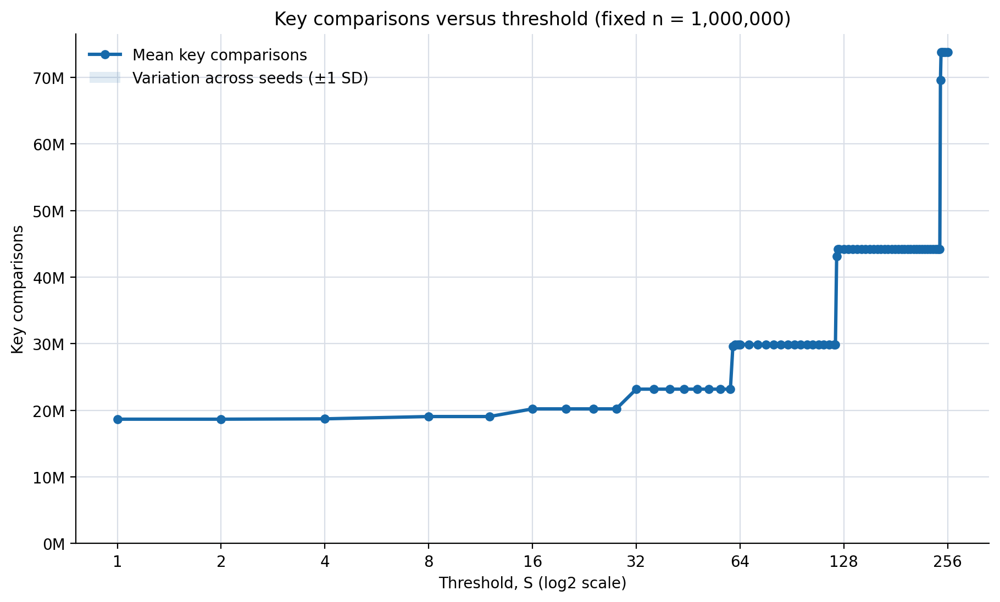
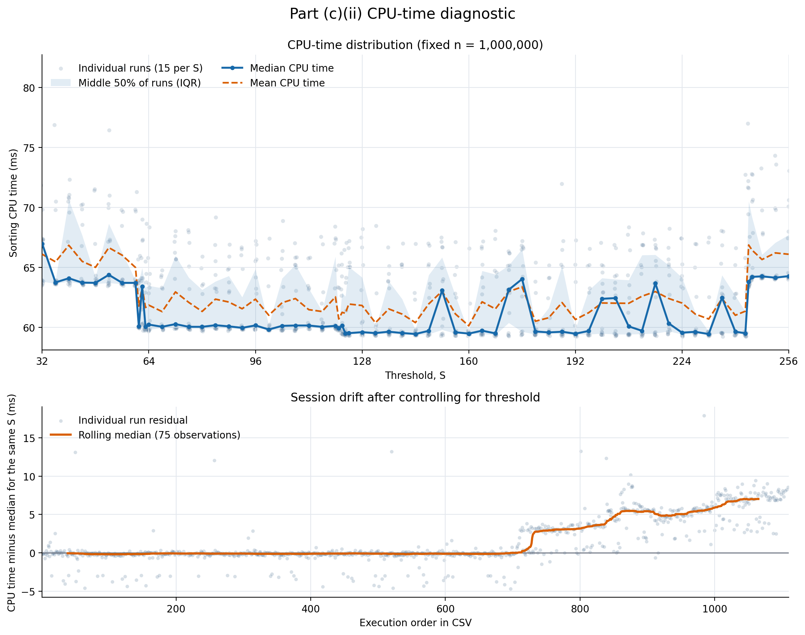
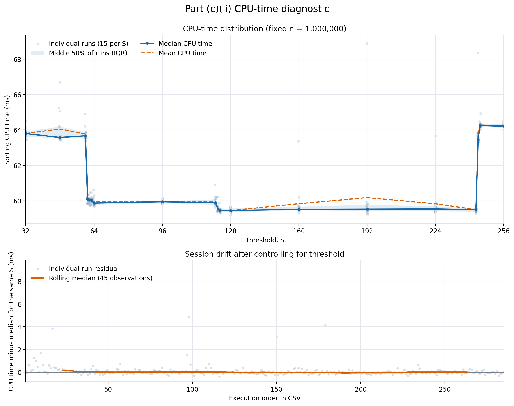
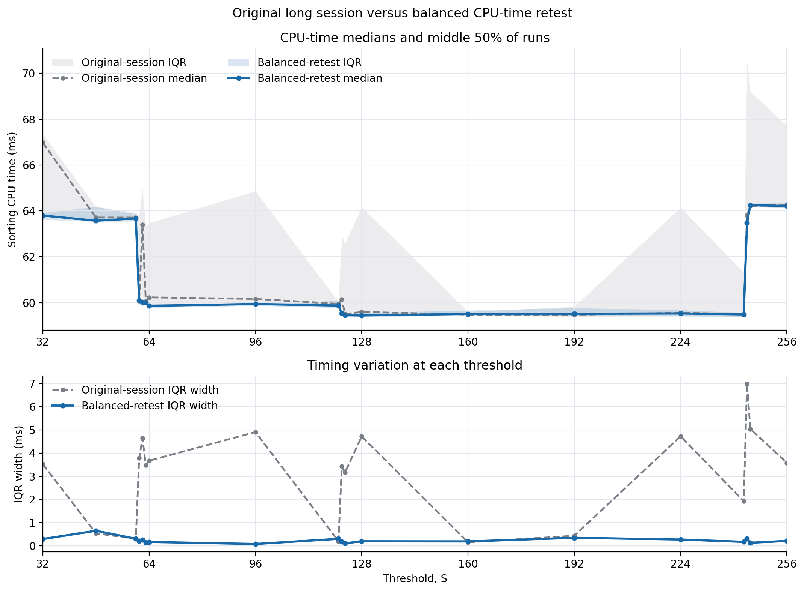

# Part (c)(ii): key comparisons versus threshold

## Question and experiment design

Part (c)(ii) asks how the number of key comparisons changes with threshold
`S` when the input size is fixed.

The investigation used two stages:

1. An initial power-of-two search with
   `S = 1, 2, 4, 8, 16, 32, 64, 128`.
2. An extended, boundary-aware search from `S = 32` to `S = 4096`. It tested
   powers of two and values immediately before and after recursion-tree
   breakpoints, including `61/62`, `121/122/123`, `244/245`, `488/489`,
   `976/977`, `1953/1954`, and `3906/3907`.

Both stages used:

- fixed input size `n = 1,000,000`;
- random values in `[1, 10,000,000]`;
- seeds `2001` through `2005` for five reproducible trials per threshold;
- Git commit `50d24f1c4ca42f11efa6c44481da7ca4ab63a701`;
- the same implementation and measurement convention.

Only comparisons between sorting keys were counted. Index checks, loop-bound
checks, and threshold checks were excluded. Input generation and sorted-output
validation were outside the timed region.

## Processing method

For each threshold, the analysis calculates the arithmetic mean and sample
standard deviation over the five seeded inputs. In the initial summary,
percentage changes use `S = 1` as the baseline. The separate extended summary
uses its first tested value, `S = 32`, as the baseline.

```text
comparison change (%) = (C(S) / C(baseline) - 1) * 100
CPU-time change (%) = (T(S) / T(baseline) - 1) * 100
```

The x-axis uses a base-2 logarithmic scale. This keeps both small and large
thresholds readable without implying that the values are evenly spaced.

## Initial search results

| S | Mean key comparisons | Sample SD | Change vs S=1 | Mean CPU time (s) | Sample SD (s) | Time change vs S=1 |
| ---: | ---: | ---: | ---: | ---: | ---: | ---: |
| 1 | 18,674,401.8 | 904.94 | 0.000% | 0.1353120 | 0.0018789 | 0.000% |
| 2 | 18,674,401.8 | 904.94 | 0.000% | 0.1119490 | 0.0018995 | -17.266% |
| 4 | 18,727,833.6 | 794.77 | 0.286% | 0.0933000 | 0.0003144 | -31.048% |
| 8 | 19,072,168.8 | 978.47 | 2.130% | 0.0796274 | 0.0001967 | -41.153% |
| 16 | 20,224,606.6 | 2,305.64 | 8.301% | 0.0704330 | 0.0001779 | -47.948% |
| 32 | 23,187,178.8 | 7,056.93 | 24.166% | 0.0634814 | 0.0002380 | -53.085% |
| 64 | 29,895,023.4 | 6,380.65 | 60.086% | 0.0598364 | 0.0002624 | -55.779% |
| 128 | 44,192,534.0 | 19,990.97 | 136.648% | 0.0595788 | 0.0003570 | -55.969% |

The initial run showed that timing was flattening near `S = 64–128`, but it
did not extend far enough to show the right-hand side of the timing valley.
This motivated the extended search.

## Extended boundary-aware search

The complete extended CSV contains 23 thresholds and 115 valid runs. Selected
rows are shown below; the complete aggregation is stored in
`results/fixed_n_1m_extended_summary.csv`.

| S | Mean key comparisons | Mean CPU time (ms) |
| ---: | ---: | ---: |
| 32 | 23,187,178.8 | 63.8300 |
| 61 | 29,652,397.4 | 60.3898 |
| 62 | 29,895,023.4 | 60.4580 |
| 64 | 29,895,023.4 | 60.0650 |
| 121 | 29,895,023.4 | 60.2344 |
| 122 | 43,169,767.6 | 59.6916 |
| 123 | 44,192,534.0 | 59.4330 |
| 128 | 44,192,534.0 | 59.3128 |
| 244 | 69,558,775.0 | 63.3968 |
| 245 | 73,746,424.6 | 64.3554 |
| 256 | 73,746,424.6 | 64.1984 |
| 488 | 116,859,624.8 | 74.0596 |
| 512 | 133,795,100.0 | 78.4958 |
| 1,024 | 254,884,899.8 | 109.8306 |
| 2,048 | 497,927,021.0 | 174.8660 |
| 4,096 | 985,699,840.0 | 308.0040 |







The extended run confirms both sides of the trade-off. Mean CPU time falls
from `63.8300 ms` at `S = 32` to its lowest observed value of `59.3128 ms` at
`S = 128`, then rises to `63.3968 ms` at `S = 244` and continues increasing
for larger thresholds. Meanwhile, key comparisons increase rapidly throughout
the search.

The thresholds `S = 123` through `S = 243` produce the same recursion-tree
structure for `n = 1,000,000`: every terminal subarray is already small enough
at `S = 123`, and no additional recursion level disappears until `S = 244`.
This is why `S = 123` and `S = 128` have exactly the same mean comparison
count. Small timing differences inside this interval should be treated as
measurement noise rather than proof of a uniquely superior threshold.

Therefore, the defensible conclusion for this input size is that the best
observed **structural region** is `S = 123–243`, with `S = 128` as a convenient
power-of-two representative. It is more precise to report this region than to
claim that `S = 128` is a universally unique optimum.

## Unified final experiment

The final experiment tested 74 thresholds from `S = 1` to `S = 256`. It used
selected small thresholds, a regular step of four from `S = 32` to `S = 256`,
and the recursion-boundary values `61, 62, 63, 121, 122, 123, 243, 244, 245`.
Each threshold used 15 seeds, giving 1,110 runs.
The runner shuffled the case order reproducibly with case-order seed `2001`,
so larger thresholds were not always measured later in the session.

The long session revealed environment-dependent timing drift. Therefore, its
1,110 measurements are retained for the dense key-comparison analysis, while
the formal CPU-time result comes from the shorter balanced retest described
below. The retest uses the median as its primary statistic and an
interquartile-range band for the middle 50% of measurements.





The dense comparison result and balanced CPU retest show step-like regions
rather than a smooth curve:

| Threshold region | Number of raw runs | Median CPU time across the region (ms) | Recursion interpretation |
| ---: | ---: | ---: | :--- |
| `32–60` | 120 | 63.741 | Earlier recursion structure |
| `61` | 15 | 60.082 | Transition point |
| `62` | 15 | 63.400 | Boundary case |
| `63–121` | 240 | 60.083 | Same recursion structure |
| `122` | 15 | 60.136 | Boundary case |
| `123–243` | 480 | 59.638 | Lowest structural region |
| `244` | 15 | 63.803 | Boundary case |
| `245–256` | 60 | 64.233 | Next recursion structure |

The absolute CPU times differ from the earlier experiment because the batches
ran under different machine conditions. Comparisons should therefore be made
within one batch, not by subtracting times from different sessions. Both
batches support the same conclusion: `S = 123–243` is the lowest structural
region, and CPU time rises once the threshold passes that region.

Dense sampling does not reveal a unique smooth optimum inside `S = 123–243`.
All thresholds in that interval produce the same recursion tree and the same
key-comparison count for a given input. The remaining point-to-point CPU-time
movement is measurement noise. `S = 128` remains a convenient representative.

## Theoretical reasoning

For fixed `n`, the Hybrid Merge Sort work can be separated into two parts:

```text
T(n, S) = Theta(n log2(n / S)) + O(nS)
```

### Merge component

Increasing `S` stops recursion earlier. The number of merge levels is roughly:

```text
log2(n / S)
```

Therefore the merge component decreases as `S` increases:

```text
Theta(n log2(n / S))
```

### Insertion Sort component

There are approximately `n / S` leaf subarrays, and sorting one leaf costs
`O(S^2)` comparisons in the general case. The total leaf cost is therefore:

```text
(n / S) * O(S^2) = O(nS)
```

This component increases with `S`. For random inputs, the average insertion
cost also grows quadratically within each leaf, so larger leaves eventually
produce many more comparisons.

### Trade-off

Increasing `S` reduces recursion, function calls, temporary-array work, and
merge overhead, but increases the amount of quadratic Insertion Sort work.
Consequently:

- smaller `S` tends to minimize key comparisons;
- moderate `S` can minimize CPU time by reducing practical overhead;
- very large `S` makes Insertion Sort dominate.

The CPU-time optimum need not equal the comparison-count optimum because CPU
time also includes memory access, copying, branching, recursion, and function
call costs that are not key comparisons.

## Interpretation and limitations

- `S = 1` and `S = 2` produced the minimum observed key-comparison count.
- The extended run establishes a CPU-time valley: time decreases before the
  `S = 123–243` structural region and increases after it.
- The 1,110-run unified search shows the strong decline before `S = 64` and
  confirms that `S = 123–243` behaves as a timing
  plateau. It does not support choosing one exact S inside that plateau.
- The threshold region was found for `n = 1,000,000` on one machine. Part
  (c)(iii) must repeat the search at different input sizes before making a
  broader recommendation.
- The final local search used 15 seeds and randomized case order. Repeated
  timings of each identical input would separate system timing noise from input
  variation even more precisely.
- The CPU-time measurements show session-dependent slowdown. After controlling
  for each threshold by subtracting its median, nearly all early measurements
  remain close to zero, while measurements near the end of the 1,110-case
  session are consistently slower. Random case order prevents this slowdown
  from being assigned only to large thresholds, but it produces right-skewed
  timing distributions whose means are generally above their medians.
- The diagnostic figure therefore displays every raw timing, the median, mean,
  and IQR, together with timing residuals in execution order. Median CPU time
  remains the primary statistic for comparing thresholds because it is less
  sensitive to the late-session slowdown.



## Balanced CPU-time retest

The CPU-time experiment was repeated using 19 representative thresholds, 15
seeds, and three balanced blocks of five seeds. Every block contained every
threshold and used an independently randomized execution order. The retest
therefore required 285 measurements rather than one uninterrupted 1,110-case
timing session. The full 74-threshold dataset remains the source for the dense
key-comparison analysis.

For an apples-to-apples stability comparison, the original session was reduced
to the same 19 thresholds and 285 observations used by the retest:

| Stability measure | Original long session | Balanced retest |
| :--- | ---: | ---: |
| Median IQR width across thresholds | 3.521 ms | 0.216 ms |
| Median absolute mean–median gap | 1.619 ms | 0.026 ms |
| Runs more than 2 ms above their threshold median | 85 / 285 (29.8%) | 5 / 285 (1.8%) |
| Median residual in final quarter | +5.613 ms | 0.000 ms |

The median IQR width decreased by approximately 93.9%, and the typical
mean–median gap decreased by approximately 98.4%. The retest diagnostic's
rolling median remains near zero throughout the session, so the sustained
late-session slowdown is no longer present.





The retest preserves the algorithmic pattern found previously. Median CPU time
is about `63.7 ms` in the sampled `S = 32–60` region, falls to approximately
`60.0 ms` around `S = 61–121`, reaches the lowest structural region at
`S = 123–243` with a regional median of `59.500 ms`, and rises to about
`64.2 ms` after `S = 245`. Among the sampled thresholds, `S = 128` has the
smallest median (`59.445 ms`), only `0.010 ms` below `S = 123`; this negligible
difference does not establish a unique optimum inside the structural region.
`S = 128` remains the representative recommendation.

## Report-ready paragraph

With the input size fixed at `n = 1,000,000`, increasing the threshold reduced
recursive Merge Sort overhead but increased the key comparisons performed by
Insertion Sort. The minimum comparison count occurred at `S = 1` and `S = 2`,
whereas CPU time reached a broad minimum in the structural region
`S = 123–243`. The initial long timing session showed late-session slowdown,
so CPU timing was repeated using 19 representative thresholds, 15 seeds, and
three balanced blocks. The retest reduced the median IQR width from `3.521 ms`
to `0.216 ms`, while preserving the observed timing pattern. Regional median
CPU time fell from approximately `63.7 ms` for the sampled `S = 32–60` values
to `60.0 ms` around `S = 61–121` and `59.500 ms` in the `S = 123–243` region,
before rising to approximately `64.2 ms` after `S = 245`. Thresholds within
`S = 123–243` yield the same recursion-tree structure and key-comparison count
for a given input, so small timing differences inside this region are
measurement noise. We therefore use `S = 128` as a convenient representative
of the best observed region, not as evidence of a universally unique optimum.
The different comparison-count and CPU-time optima demonstrate that CPU time
also depends on recursion, copying, memory access, and control-flow overhead.

## Presentation summary

- Fix `n = 1,000,000`; use a coarse search followed by a dense local search.
- Use selected small thresholds plus a dense `S = 32–256` search; values above
  256 are unnecessary for the final figure because the upward transition is
  already visible.
- Use the dense 15-seed search for key comparisons and the shorter balanced
  retest for the formal CPU-time figure.
- Key comparisons are minimized at `S = 1–2` and rise strongly with `S`.
- CPU time forms step-like plateaus; the best structural region is
  `S = 123–243`.
- Use `S = 128` as the representative threshold for this input size.
- Explain why minimum comparisons and minimum CPU time occur at different
  thresholds.
- Part (c)(iii) confirms how the suitable region changes with `n`; its common
  region is reported separately in `docs/part-c-iii-analysis.md`.
