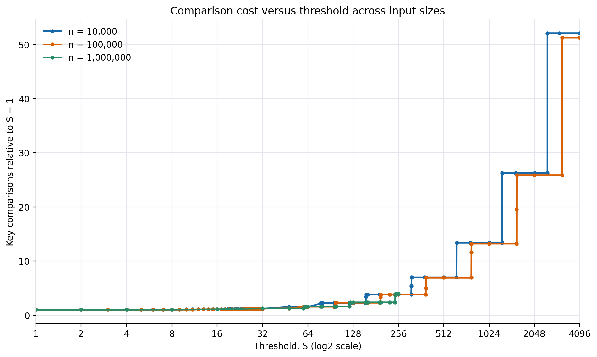
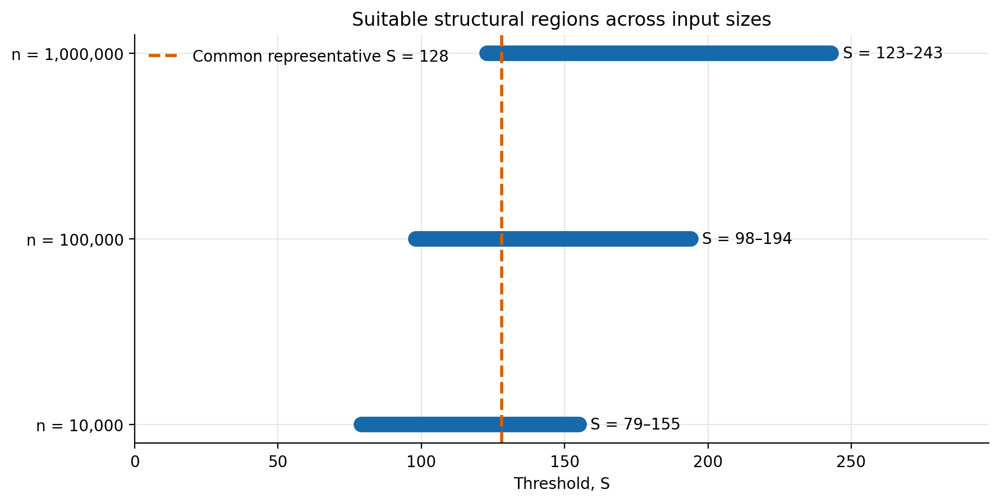
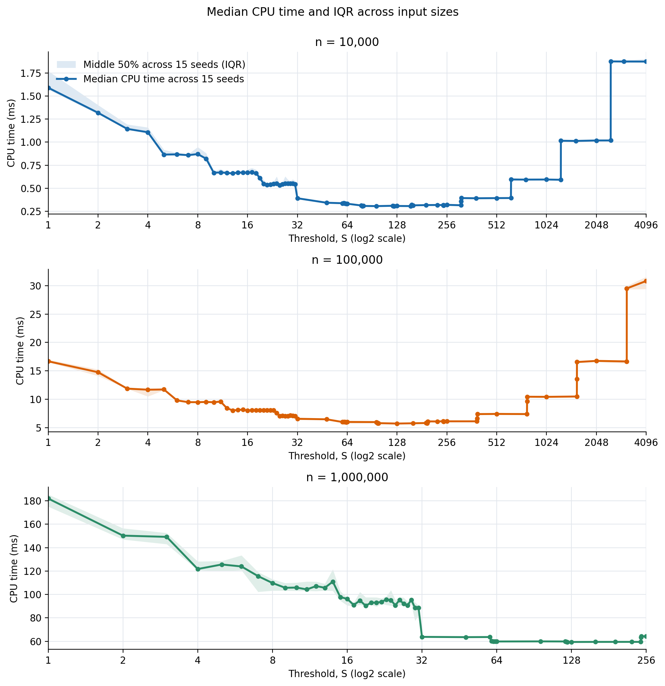
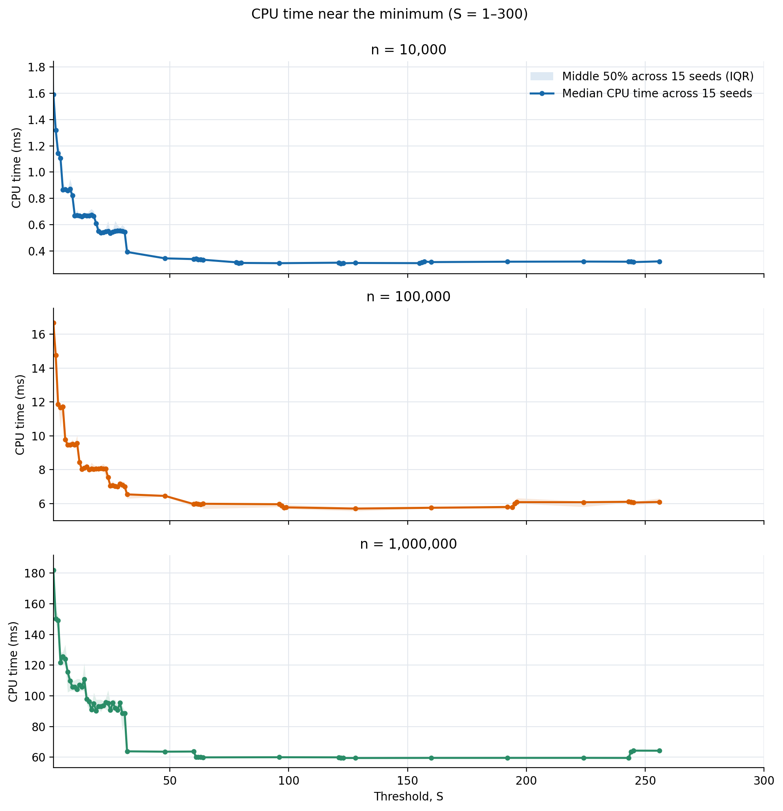
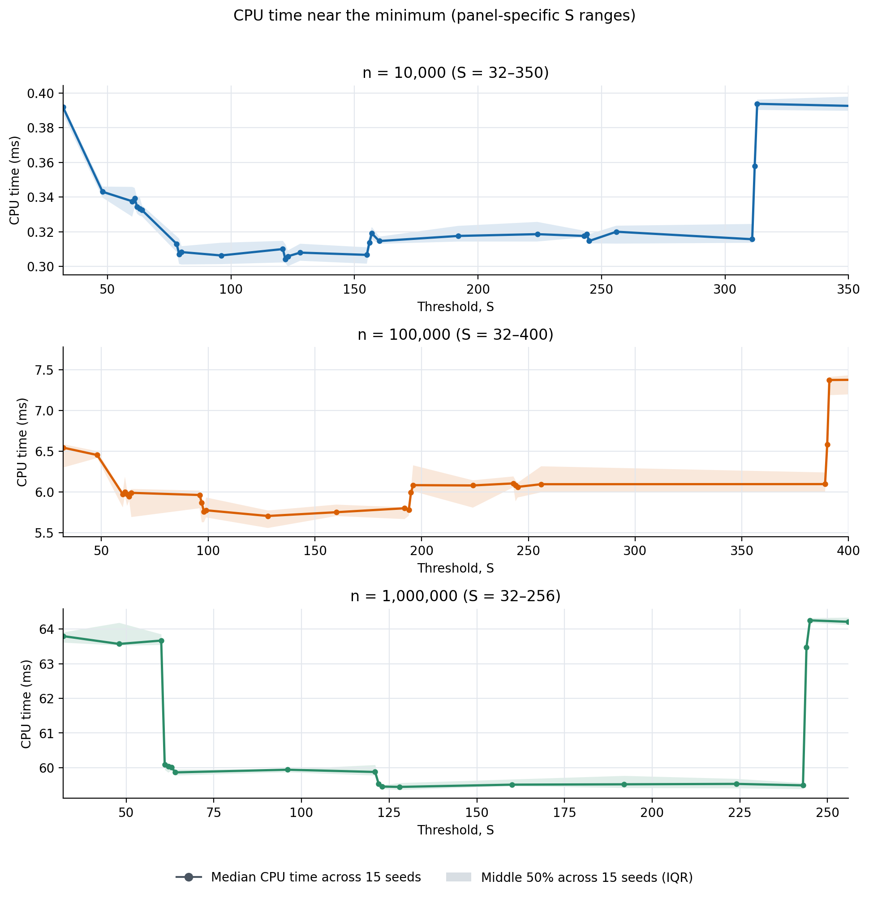

# Part (c)(iii): a suitable threshold across input sizes

## Question

Part (c)(iii) asks how to determine a suitable threshold `S` using different
input sizes. The goal is not to claim that one noisy timing measurement is a
universal optimum. Instead, we identify recursion-tree regions that have the
same key-comparison behaviour, compare their CPU-time distributions, and look
for a threshold that remains inside a good region for every tested `n`.

## Algorithmic explanation

For a fixed threshold, Hybrid Merge Sort recursively divides an input until a
subarray has size at most `S`. At recursion depth `k`, a leaf has size roughly

```text
n / 2^k.
```

The stopping depth is therefore approximately

```text
k = ceil(log2(n / S)).
```

Because `k` is an integer, changing `S` by one usually does not alter the
recursion tree. A range of neighbouring thresholds can therefore produce the
same leaf partition and exactly the same key-comparison count for a given
input. Once `S` crosses the largest leaf size at the next level, the algorithm
stops one level earlier. The leaves become larger, the insertion-sort work
increases sharply, and the comparison graph jumps to a new plateau.

The approximate work can be separated into

```text
T(n, S) = Theta(n log2(n / S)) + O(nS).
```

The first term decreases as `S` grows because there are fewer merge levels.
The second term increases because Insertion Sort is quadratic within each
leaf. CPU time can therefore favour a moderate `S`, even though the smallest
`S` values minimize key comparisons. The plateau boundaries move as `n`
changes because the sizes created by repeatedly halving `n` also change.

## Experimental method

The experiment used three input sizes:

```text
n = 10,000; 100,000; 1,000,000
```

An initial common scan tested the same 36 candidate thresholds at each size:

```text
1, 2, 4, 8, 16, 32, 48, 60, 61, 62, 63, 64,
78, 79, 80, 96, 97, 98, 99, 121, 122, 123, 128,
155, 156, 157, 160, 192, 194, 195, 196, 224,
243, 244, 245, 256
```

Each configuration used 15 reproducible inputs with seeds `2001–2015` and
values in `[1, 10,000,000]`. Execution was divided into three balanced blocks
of five seeds, with independently randomized case order inside each block.

The initial CPU plots for `n = 10,000` and `n = 100,000` ended at `S = 256`,
before a decisive right-hand rise was visible. They were therefore not
sufficient to identify a minimum region. Both studies were extended to
`S = 4,096`, with additional samples immediately around the expected
recursion boundaries. The `n = 10,000` experiment used 100 timed repetitions
per configuration, and the `n = 100,000` experiment used 10. Each CSV timing
is the mean of those repetitions; input copying and validation remain outside
the timed intervals. This reduces the relative timing noise for short sorts.

The stable balanced Part (c)(ii) retest supplies the `n = 1,000,000` CPU data.
All experiments use 15 seeds and three balanced blocks. The original,
insufficiently wide scans are retained for audit and are not overwritten.
The final charts also include the left side from the smallest valid threshold,
`S = 1`. A threshold of zero is not defined for the hybrid stopping condition;
original Merge Sort is treated as a separate algorithm in Part (d).

## Results

The suitable region is the multi-threshold comparison plateau with the lowest
regional median CPU time among the sampled plateaus.

| Input size `n` | Suitable structural region | Regional median CPU time | Next upward transition |
| ---: | ---: | ---: | ---: |
| 10,000 | `S = 79–155` | 0.3069 ms | `S = 156–157` |
| 100,000 | `S = 98–194` | 5.7687 ms | `S = 195–196` |
| 1,000,000 | `S = 123–243` | 59.5000 ms | `S = 244–245` |

The regions shift to larger thresholds as `n` increases, but their common
intersection is

```text
S = 123–155.
```

`S = 128` lies inside all three regions and is a convenient power-of-two
representative. It is therefore the recommended threshold for the subsequent
comparison with original Merge Sort. This is a robust region-based choice,
not a claim that `128` is the uniquely fastest value on every machine.



The normalized comparison graph uses `S = 1` as the baseline for each input
size and shows
the expected stair-step increases. The
different jump locations are evidence that recursion boundaries depend on
`n`, rather than evidence of a smooth optimum at one exact threshold.



The interval plot makes the cross-size decision explicit: `S = 128` is inside
the suitable region for every tested input size.



The expanded overview now shows both sides of the timing valley for all three
input sizes. Repeated timing substantially narrows the uncertainty for the two
smaller inputs. At `n = 10,000`, CPU time rises at the `312–313` boundary and
continues increasing at later boundaries. At `n = 100,000`, it rises at
`195–196`, jumps again at `390–391`, and continues upward. The conclusion uses
regional medians together with exact comparison plateaus, rather than ranking
thresholds by tiny point-to-point timing differences. Absolute CPU times from
different repetition settings or sessions should not be compared directly.

For the final presentation, `finalize/part_c_iii/` also contains sparse
overview versions that show only the measured powers-of-two thresholds. The
full boundary-point figures here remain the analysis record. The sparse
overview changes no source rows, summary values, or suitable-region
calculations; it is followed by the dense local CPU zoom and the interval
summary of suitable regions.



The `S = 1–300` view keeps the left-side decrease visible alongside the
minimum regions. The overview shows that later thresholds continue to get
slower; the panel-specific view below gives each input size a more useful
right-hand boundary for inspecting its upward transition.



The panel-specific ranges (`S = 32–350`, `32–400`, and `32–256`) show each
input size's low-time region and an upward transition without compressing all
three panels to the same horizontal span. For `n = 10,000`, the last plotted
visible measurement is `S = 313`; the horizontal segment after it connects
to the next measured point at `S = 384`, which is outside the zoom. This
segment is an interpolation between two measured points, not a measurement
at `S = 350`. For `n = 100,000`, the last visible measurement is `S = 391`;
the short segment to the right connects to the measured `S = 512` point
outside this zoom. It does not imply a measurement at `S = 400`. The
`n = 1,000,000` measurements stop at `S = 256`. The figure-wide legend
describes all three colored panels. Different horizontal scales mean positions
should not be compared visually across panels; read the numeric S values
instead.

### Final zoom-figure record

This was a presentation-only revision: no new sort runs or CSV edits were
made. The figure uses the same 15-seed CPU summaries as the wider Part
(c)(iii) chart. Each point is a measured threshold's median; the shaded band
joins its first and third quartiles. Lines between points are visual
interpolation, not additional threshold measurements.

| Input size | Displayed S range | Last visible measured S | Measured point supporting the right-edge segment | CPU source files |
| ---: | ---: | ---: | ---: | --- |
| 10,000 | 32–350 | 313 | 384 (outside frame) | `part_c_iii_n10k_left_repeated.csv`, `part_c_iii_n10k_expanded_repeated.csv` |
| 100,000 | 32–400 | 391 | 512 (outside frame) | `part_c_iii_n100k_left_repeated.csv`, `part_c_iii_n100k_expanded_repeated.csv` |
| 1,000,000 | 32–256 | 256 | None; the series ends at 256 | `part_c_iii_n1m_left_balanced.csv`, `fixed_n_1m_cpu_retest_balanced.csv` |

The source files are under `results/`. Earlier overview and zoom figures
remain in `figures/part_c_iii/` for comparison and audit. The revised
panel-specific figure is `part_c_iii_cpu_time_zoom_by_n.png`.

These figures use the original sorting implementation, not the separate
`reserve` sensitivity variant. Reserving the merge temporary vector's
capacity improved CPU time in a controlled check and shifted the fastest of
nine sampled thresholds from `S = 128` to `S = 64` for `n = 1,000,000`.
This shows that timing-based threshold choices depend on implementation
details as well as the algorithm and machine. We retain the original
implementation for the main Part (c) results and the planned Part (d)
comparison so they remain comparable; the sensitivity check is a limitation,
not a replacement dataset.

## Conclusion

The experiment shows that a suitable `S` depends on input size at the level of
recursion-tree boundaries: the lowest observed structural region moves from
`79–155` at `n = 10,000`, to `98–194` at `n = 100,000`, and to `123–243` at
`n = 1,000,000`. Nevertheless, the intervals overlap at `S = 123–155`.
Selecting `S = 128` gives one simple threshold that remains in the favourable
region for all tested sizes and balances reduced recursive/merge overhead
against increased Insertion Sort work.

## Report-ready paragraph

To determine a suitable threshold across input sizes, we first tested 36
candidate values of `S` for `n = 10,000`, `100,000`, and `1,000,000`, using 15
seeded random inputs per configuration and balanced randomized execution
blocks. Because the initial two smaller-input scans ended before a clear
right-hand increase, we extended them to `S = 4,096` and used repeated timing
to reduce sub-millisecond measurement noise.
The key-comparison curves formed plateaus because neighbouring thresholds often
produce the same integer recursion depth and leaf partition. The lowest
CPU-time structural regions were `S = 79–155`, `98–194`, and `123–243` for the
three respective input sizes. Their intersection is `S = 123–155`; therefore,
we selected `S = 128` as a convenient representative for Part (d). This choice
is based on a stable region rather than one noisy minimum. The result also
illustrates the hybrid trade-off: increasing `S` removes recursive merge
levels, but eventually creates larger subarrays on which quadratic Insertion
Sort performs substantially more key comparisons.
