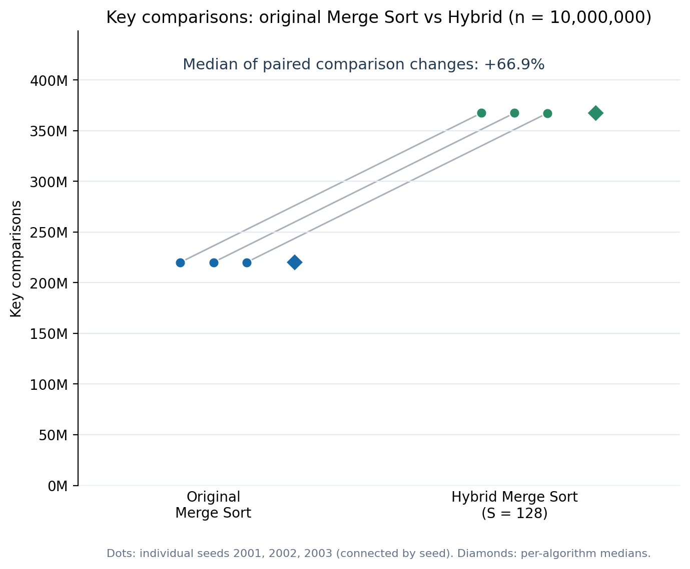
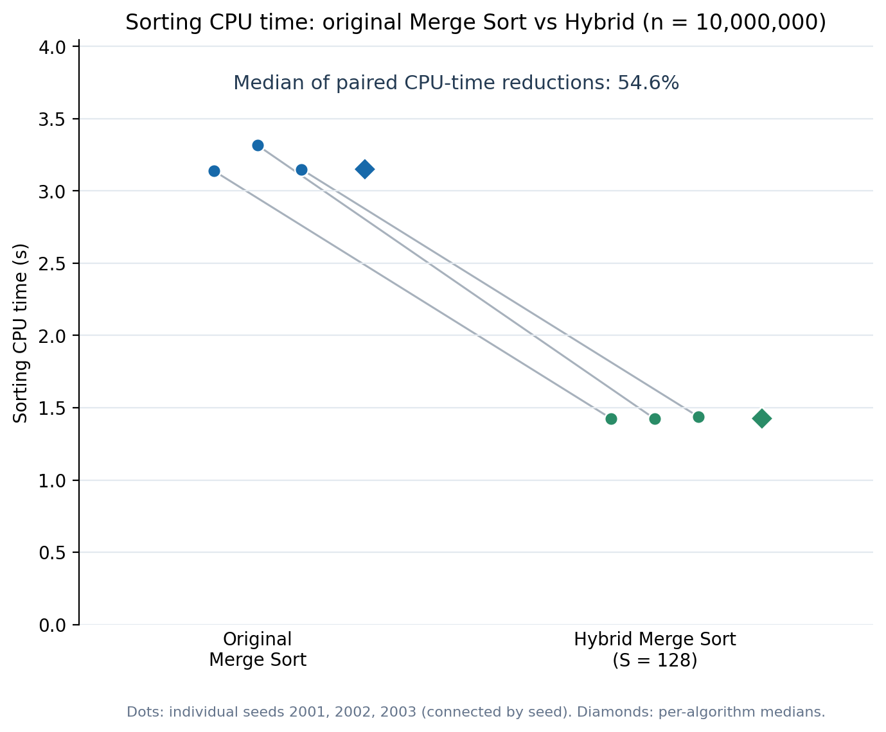

# Part (d): 10-million-integer comparison

## Method

We compared original Merge Sort with the current Hybrid Merge Sort at
`S = 128`, selected from Part (c)(iii). Both algorithms sorted the same
seeded random input for each of seeds `2001`, `2002`, and `2003`, with
`n = 10,000,000` and values in `[1, 10,000,000]`. The runner randomized the
six-case execution order with order seed `7101`. Each case had one timed sort.
The C++ runner measured sorting-only process CPU time using `std::clock`;
input generation, input copying, and sorted-output validation were excluded
from the timed interval. All sorting and input tests passed before the run.

Raw observations and run order are in
[`../results/part_d_original_vs_hybrid_s128.csv`](../results/part_d_original_vs_hybrid_s128.csv).
The matching `.meta.json` records the command, compiler, platform, and Git
state. The worktree was dirty at measurement time; the recorded HEAD was
`50d24f1c4ca42f11efa6c44481da7ca4ab63a701`. No `reserve` variant was
used. In the CSV, `S = 0` for original Merge Sort means the threshold is not
applicable, not that Hybrid used a zero threshold.

## Results

| Seed | Merge key comparisons | Hybrid key comparisons | Hybrid comparison change | Merge CPU (s) | Hybrid CPU (s) | Hybrid CPU-time reduction |
| ---: | ---: | ---: | ---: | ---: | ---: | ---: |
| 2001 | 220,100,979 | 367,358,957 | +66.905% | 3.138958 | 1.425589 | 54.584% |
| 2002 | 220,101,212 | 367,394,077 | +66.921% | 3.315683 | 1.423161 | 57.078% |
| 2003 | 220,102,187 | 367,347,782 | +66.899% | 3.150718 | 1.437979 | 54.360% |
| Median | 220,101,212 | 367,358,957 | +66.905% | 3.150718 | 1.425589 | 54.584% |

Percentages in the body are paired by seed. The median comparison change and
CPU-time reduction are medians of those paired percentages. The median paired
CPU-time speedup is about `2.20×`. The per-seed pairs and the derived
percentages are also in
[`../results/part_d_original_vs_hybrid_s128_summary.csv`](../results/part_d_original_vs_hybrid_s128_summary.csv),
produced by
[`../experiments/scripts/analyze_part_d.py`](../experiments/scripts/analyze_part_d.py).

Each figure shows one dot per seed and algorithm, with a thin line joining
observations from the same seed. Diamonds mark the per-algorithm medians.
The headline percentages are medians of the three *paired percentage changes*,
not percentages computed from the two per-algorithm medians. The earlier
mean-bar versions remain in `figures/part_d/` for comparison and audit.
In the CPU-time figure, seed `2002` sits noticeably above the other two
seeds for original Merge Sort (`3.316s` versus `3.139–3.151s`); this is the
largest single-run deviation in the dataset and is consistent with ordinary
session/OS scheduling noise rather than a systematic effect, since Hybrid's
three CPU times stay tightly clustered (`1.423–1.438s`) and the ranking
(Hybrid faster than Merge) holds for every seed regardless.

Hybrid made **more** key comparisons at `S = 128` but used **less** CPU time
on all three inputs. This is possible because key-comparison count measures
only comparisons between sorting values; it does not count recursion,
temporary-vector allocation/growth, copying, or other instructions. Stopping
recursion earlier plausibly reduces enough overhead to outweigh additional
Insertion Sort comparisons.

This mechanism was checked directly with call-count and heap-allocation
instrumentation, documented in
[`merge-call-profiling.md`](merge-call-profiling.md). At this `n` and `S`,
`merge()` runs `9,999,999` times for original Merge Sort versus `131,071`
times for Hybrid (about `76×` fewer calls), and heap allocation calls fall by
about `25.7×`. Both counts are seed-independent, since the recursive split
points depend only on subarray sizes. This supports recursion/allocation
overhead, not the comparison count, as the dominant cost behind the measured
CPU-time gap; it is evidence from instrumentation of the actual code, not a
sampling profiler's time attribution.

## Cross-check against Member B's Part (c) results

The remote `origin/develop` commit `58b0d5b` adds Member B's Part (c)(i),
(ii), and (iii) CSV files. We compared every row against our local initial
datasets using the exact key `(study, algorithm, n, S, x, seed)`. All `25 +
40 + 120 = 185` configurations matched, and **all 185 key-comparison counts
were identical**. This supports consistent input generation, sorting logic,
and counting across the two machines for those configurations.

In the coarse Part (c)(iii) scan with powers-of-two S values, Member B's
lowest sampled median CPU time occurred at `S = 64` for `n = 10,000` and at
`S = 128` for `n = 100,000` and `1,000,000`. Our initial coarse scan chose
`128` at all three sizes. The small-input difference concerns sub-millisecond
timing on different machines; it does not contradict the later 15-seed,
denser Part (c)(iii) finding that `S = 128` lies in a suitable common region.
Absolute CPU times from the two machines should not be combined or treated
as a direct speed comparison.

## Limits and report conclusion

This is a three-seed CPU-time comparison on one machine and one source
version. The run order was randomized, but the algorithms were not timed as
adjacent pairs for every seed, so session drift remains possible. The timing
gap is large and has the same direction in all three pairs; precise percentage
estimates should still be described as observed values, not universal
constants. If a tighter estimate is needed, run additional seeds in a new
file without overwriting these observations.

For the tested implementation and `S = 128`, Hybrid Merge Sort used about
`66.9%` more key comparisons yet about `54.6%` less process CPU time than
original Merge Sort on ten million integers. This illustrates why the
assignment asks for both measures.
