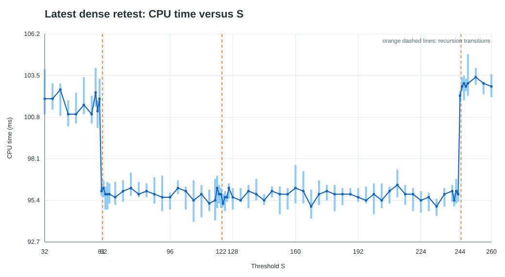
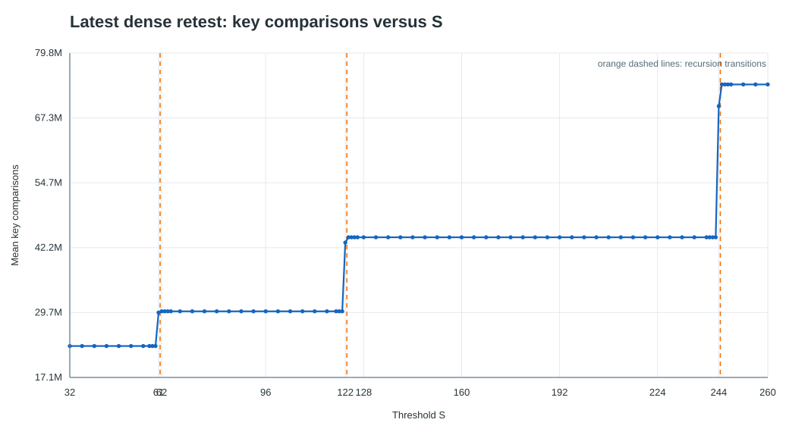
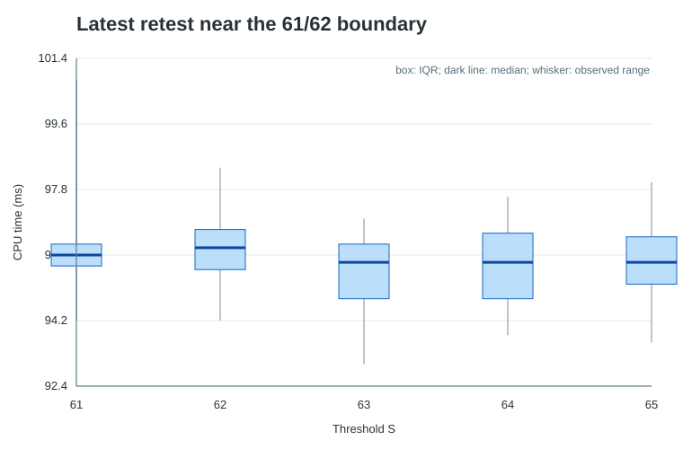
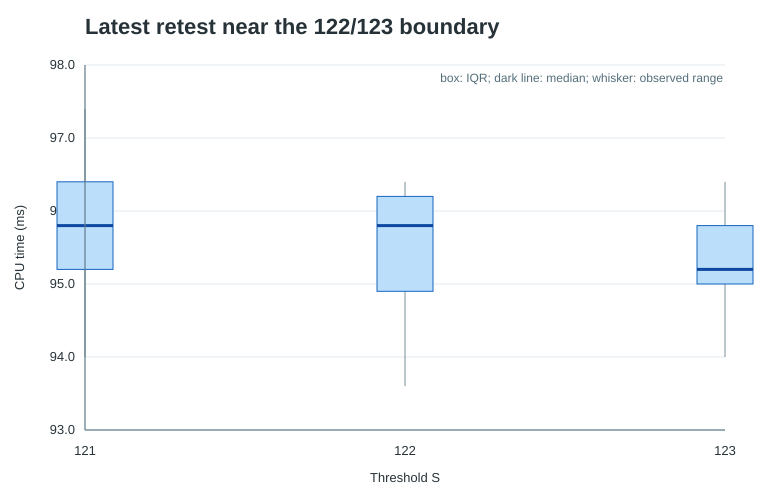
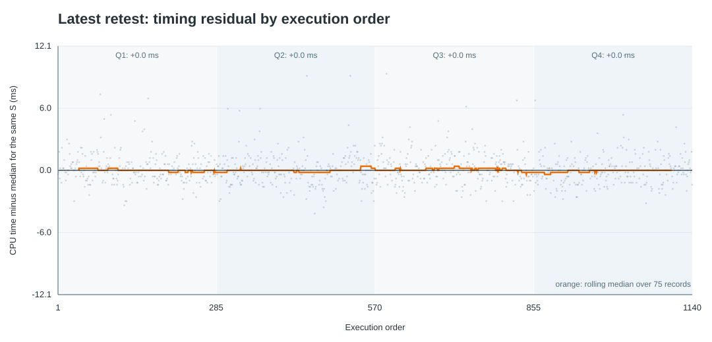

# Part (c)(ii) Latest Retest Report: Effect of Threshold S on Local CPU Time

## Abstract

This report uses the latest, second dense experiment as its primary dataset to investigate how the Hybrid Merge Sort threshold `S` affects key comparisons and CPU time when the input size is fixed at `n = 1,000,000`. The experiment tested 76 thresholds within `S = 32–260`. Each threshold used 15 random seeds, and every recorded case averaged five consecutive sorts, producing 1,140 records in total.

The latest results again show that `S = 62` is not an anomalous point. Its median CPU time is `96.2 ms`, with an interquartile range of `95.6–96.7 ms`, which overlaps substantially with `S = 61, 63, 64, 65`. The pooled medians of the two major structural regions `S = 62–121` and `S = 123–243` are both `95.8 ms`. No uniquely optimal threshold can be identified reliably on this machine. A more defensible conclusion is that `S = 61–243` forms a broad low-time region, after which CPU time rises clearly to approximately `102–103 ms` at the `244/245` transition.

The execution order was also re-randomized in this experiment. The median timing residual in each of the four execution quarters was approximately `0.0 ms`, so the temporary `+1.4 ms` slowdown in the third quarter of the previous run was not reproduced. The earlier drift should therefore be interpreted as one-time environmental noise rather than a stable property of the algorithm or a fixed phase of the experiment.

## 1. Experimental Design

### 1.1 Fixed parameters

- Input size: `n = 1,000,000`;
- Random integer range: `[1, 10,000,000]`;
- Input seeds: `2001–2015`, giving 15 independent inputs;
- Operating system: Windows 11;
- Compiler: MinGW-W64 GCC 14.2.0;
- Compiler optimization: `-O2`;
- Sorting implementation Git commit: `518cfb28735613a8071e4dd7df7254a23d90cf3a`;
- Case-order random seed: `19202`.

### 1.2 Threshold range

The experiment used a base grid from `S = 32` to `S = 260` with a step of four, together with consecutive samples around three recursion-structure transitions:

- `S = 58–65`;
- `S = 119–126`;
- `S = 241–248`.

This produced 76 distinct thresholds. Every threshold used the same 15 seeds.

### 1.3 Timing and interference controls

The program used `std::clock()` to measure sorting only. Input generation, input copying, and sorted-output validation were excluded from the timed interval. Each record averaged five consecutive sorts of the same input. This reduces the effect of the approximately `1 ms` base clock granularity observed on Windows and gives records in increments of approximately `0.2 ms`.

The 15 seeds were divided into three balanced blocks. Each block contained all 76 thresholds and five seeds, and the case order was randomized independently within each block. This prevented any threshold from always running during a fixed period in which the machine was cooler, warmer, or under a different background load. Every completed sort was checked for correctness.

### 1.4 Statistical processing

For key comparisons, the report uses the arithmetic mean and sample standard deviation across the 15 seeds. For CPU time, the median and interquartile range (IQR) are the primary statistics because they are less sensitive than the mean to occasional slow measurements. Structural-region summaries pool all raw records in the region, whereas single-boundary comparisons retain 15 observations for every `S`.

Because the latest dataset begins at `S = 32`, percentage changes in key comparisons use `S = 32` as the baseline:

```text
comparison change (%) = (C(S) / C(32) - 1) × 100
```

Absolute CPU times from separate sessions are not subtracted from one another. The previous session is used only to determine whether timing drift was reproduced; it is not used to rank thresholds in the latest run.

## 2. Latest Overall Results

### 2.1 CPU time versus S



The latest data can be divided into three main timing regimes:

| Structural region | Thresholds | Raw observations | Median CPU time (ms) | Mean CPU time (ms) | Q1–Q3 (ms) |
| :--- | ---: | ---: | ---: | ---: | :--- |
| `32–60` | 10 | 150 | 101.8 | 102.019 | 100.8–103.0 |
| `61` | 1 | 15 | 96.0 | 96.160 | 95.7–96.3 |
| `62–121` | 20 | 300 | 95.8 | 95.889 | 95.0–96.6 |
| `122` | 1 | 15 | 95.8 | 95.413 | 94.9–96.2 |
| `123–243` | 36 | 540 | 95.8 | 95.832 | 95.0–96.4 |
| `244` | 1 | 15 | 102.2 | 102.147 | 101.8–102.5 |
| `245–260` | 7 | 105 | 103.0 | 102.968 | 102.4–103.8 |

From `S = 32–60` to `S = 61–243`, the regional median fell from `101.8 ms` to approximately `95.8–96.0 ms`. This indicates that the time saved by reducing recursion, merging, function calls, and temporary-array operations exceeded the additional cost of Insertion Sort.

After `S` reached the `244/245` transition, leaf subarrays grew to approximately 244–245 elements and the quadratic cost of Insertion Sort began to dominate. CPU time rose to approximately `102–103 ms`. This increase of roughly `7 ms` is substantially larger than the sub-millisecond movements commonly observed within the low-time plateau.

### 2.2 Key-comparison count



The number of key comparisons increased in structural steps rather than along a smooth curve. The recursion tree changes only when `S` crosses a subarray length that actually occurs during recursive splitting:

| S or structural region | Mean key comparisons | Change from `S=32` |
| :--- | ---: | ---: |
| `32–60` | 23,185,110.1 | 0.000% |
| `61` | 29,652,815.7 | +27.896% |
| `62–121` | 29,896,880.4 | +28.949% |
| `122` | 43,179,802.1 | +86.239% |
| `123–243` | 44,200,395.9 | +90.641% |
| `244` | 69,552,148.5 | +199.986% |
| `245–260` | 73,739,407.1 | +218.046% |

The region with the fewest comparisons is not the region with the lowest CPU time. Key-comparison counting excludes recursion calls, memory allocation, data copying, merge writes, cache access, and branch-control costs that contribute to actual execution time.

The step positions follow directly from balanced recursive splitting of one million elements:

| Recursion depth | Possible subarray sizes | Important threshold transition |
| ---: | :--- | :--- |
| 14 | 61 or 62 | `61/62` |
| 13 | 122 or 123 | `122/123` |
| 12 | 244 or 245 | `244/245` |

When a boundary is crossed, many subarrays simultaneously stop recursing and switch to Insertion Sort. The resulting jumps in comparison count are therefore genuine algorithmic-structure changes.

## 3. Is S = 62 Anomalous?

### 3.1 Recursion boundary

For `n = 1,000,000`, the subarrays at recursion depth 14 can have lengths of only 61 or 62:

- At `S = 61`, length-61 subarrays stop recursing, whereas length-62 subarrays split again;
- At `S = 62`, both length-61 and length-62 subarrays stop recursing;
- From `S = 62` through `S = 121`, no additional recursion level disappears, so the recursion tree remains unchanged.

The comparison-count jump from `S = 61` to `S = 62` is therefore a real consequence of the algorithmic structure. However, there is no algorithmic reason for CPU time at `S = 62` to be independently higher than at `S = 63–65`, because these thresholds execute the same recursion tree and the same number of key comparisons for a given input.

### 3.2 Latest boundary data

| S | Mean key comparisons | Mean CPU time (ms) | Median CPU time (ms) | Q1–Q3 (ms) |
| ---: | ---: | ---: | ---: | :--- |
| 61 | 29,652,815.7 | 96.160 | 96.0 | 95.7–96.3 |
| 62 | 29,896,880.4 | 96.187 | 96.2 | 95.6–96.7 |
| 63 | 29,896,880.4 | 95.520 | 95.8 | 94.8–96.3 |
| 64 | 29,896,880.4 | 95.747 | 95.8 | 94.8–96.6 |
| 65 | 29,896,880.4 | 95.880 | 95.8 | 95.2–96.5 |



The median at `S = 62` is only `0.4 ms` higher than those at `S = 63–65`, and its IQR overlaps heavily with all neighboring thresholds. This difference is close to the approximately `0.2 ms` effective granularity of one recorded case and cannot support a stable performance distinction. More importantly, the latest `S = 62` median of `96.2 ms` is very close to the previous run's `96.4 ms`, again rejecting the isolated peak seen in the early data.

Thus, `S = 62` is a recursion-structure boundary, but it is not a CPU-time anomaly.

### 3.3 Paired check using the same seeds

To remove differences between random inputs as a possible confounder, the time at `S = 62` was paired with the neighboring-threshold time for the same seed. The paired difference is defined as `time(S=62) - time(neighboring S)`:

| Pair | `S=62` faster | Neighbor faster | Ties | Median paired difference (ms) | Two-sided sign-test p-value |
| :--- | ---: | ---: | ---: | ---: | ---: |
| `62` versus `63` | 5 | 8 | 2 | +0.2 | 0.581 |
| `62` versus `64` | 4 | 9 | 2 | +0.4 | 0.267 |
| `62` versus `65` | 7 | 7 | 1 | 0.0 | 1.000 |

None of the three comparisons shows a stable difference. In particular, `S = 62` and `S = 65` each won for seven seeds, and their median paired difference was zero. This further indicates that the small movements in the mean or median at `S = 62` are timing variation rather than a threshold-specific anomaly.

## 4. Equal-Sample Check at the S = 122 Boundary

The earlier analysis specifically examined whether `S = 122` appeared unusual because its sample size differed from those of pooled neighboring regions. In the latest dense experiment, `S = 121, 122, 123` each already have the same 15 observations, so they can be compared directly with equal sample sizes:

| S | Observations | Median CPU time (ms) | Mean CPU time (ms) | Q1–Q3 (ms) |
| ---: | ---: | ---: | ---: | :--- |
| 121 | 15 | 95.8 | 95.787 | 95.2–96.4 |
| 122 | 15 | 95.8 | 95.413 | 94.9–96.2 |
| 123 | 15 | 95.2 | 95.293 | 95.0–95.8 |



Although the sample median at `S = 123` is `0.6 ms` below those at `S = 121/122`, the three IQRs still overlap substantially. In same-seed pairs, `S = 121` and `S = 122` were each faster seven times with one tie; `S = 122` was faster seven times, whereas `S = 123` was faster six times with two ties. Both two-sided sign tests gave `p = 1.000`, so there is no evidence that any of these thresholds is consistently faster. The latest run therefore does not support treating either `S = 122` or `S = 123` as a unique optimum.

## 5. Is There a Unique Optimum Within the Low-Time Plateau?

The lowest individual threshold median in the latest run is `95.0 ms`, observed at `S = 168` and `S = 232`. This does not establish either threshold as a unique optimum because:

- Most medians throughout `S = 61–243` lie within approximately `95–97 ms`;
- Each individual threshold has only 15 observations;
- The IQRs of neighboring thresholds overlap heavily;
- The pooled medians of `S = 62–121` and `S = 123–243` are identical at `95.8 ms`;
- Sub-millisecond differences are on the same scale as clock granularity, CPU-state variation, and run noise.

At `S = 128`, the median is `95.6 ms` and the IQR is `94.8–96.2 ms`, placing it well inside the low-time plateau. It remains a convenient, robust, and easily explained representative value, but it should not be described as uniquely optimal on every machine or in every run.

## 6. Latest Session-Drift Check

To determine whether the previous third-quarter offset of `+1.4 ms` would recur, the latest experiment retained the same case matrix but changed the case-order random seed from `9202` to `19202`.

| Diagnostic | Previous run | Latest retest |
| :--- | :--- | :--- |
| Median residuals in the four execution quarters (ms) | `0.0, -0.2, +1.4, -0.2` | `0.0, 0.0, 0.0, 0.0` |
| Median residuals in the three balanced blocks (ms) | `0.0, +0.2, -0.2` | `0.0, 0.0, 0.0` |
| Range of the 75-record rolling median (ms) | `-0.8–+6.2` | `-0.4–+0.4` |
| Correlation between timing and comparison-count residuals | `-0.030` | `+0.034` |



No execution phase in the latest retest remained consistently slower. The remaining rolling offset did not exceed approximately `0.4 ms`, which is close to the effective resolution of the current timing method. This indicates that the earlier temporary slowdown was neither a fixed algorithmic effect nor the result of a group of random inputs requiring more comparisons. The most plausible explanation is a transient change in CPU frequency or temperature, background-process activity, core migration, cache state, or memory contention. Because those system metrics were not logged during the run, the data cannot identify one unique cause.

## 7. Theoretical Explanation

For fixed `n`, the work performed by Hybrid Merge Sort can be approximated by:

```text
T(n, S) = Θ(n log2(n / S)) + O(nS)
```

### 7.1 Merge component

Increasing `S` stops recursion earlier. The approximate number of merge levels is `log2(n/S)`, so the merge component decreases as `S` grows. Removing one recursion level also avoids many function calls, temporary-array allocations, data copies, and merge-loop operations.

### 7.2 Insertion Sort component

There are approximately `n/S` leaf subarrays. Applying Insertion Sort to one leaf of length approximately `S` generally requires `O(S²)` work, so the total leaf cost is approximately:

```text
(n / S) × O(S²) = O(nS)
```

This component grows with `S`. Once the leaf size reaches approximately 244–245 elements, the added Insertion Sort cost exceeds the saving from removing another merge level, and CPU time rises again.

### 7.3 Why the comparison-count and CPU-time optima differ

Smaller `S` values retain more merge levels but perform less Insertion Sort work, which lowers the key-comparison count. Moderate `S` values perform more comparisons but reduce recursion, allocation, copying, and merging overhead enough to lower total CPU time. CPU time also includes memory access, cache behavior, branching, and control-flow costs, so it need not reach its minimum at the same `S` as the key-comparison count.

The three regimes in the latest local data—`32–60 → 61–243 → 244–260`—are consistent with this theoretical trade-off.

## 8. Scope and Limitations

- The latest run retested only `S = 32–260`; it did not rerun `S = 1–28`. Consequently, this report does not use CPU times from the old session to extend the latest curve and does not reassert an absolute minimum outside the latest tested range.
- Every threshold uses 15 independent random inputs. The five sorts within each record reduce timing-granularity effects; they do not create five additional independent inputs.
- Single-boundary comparisons use equal sample sizes, but 15 seeds still provide limited power for sub-millisecond effects. The interpretation therefore emphasizes paired results, IQRs, and structural regions rather than choosing an optimum from one lowest median.
- CPU time depends on the processor, compiler, allocator, operating system, clock implementation, and background workload. Another machine may favor a different representative value within the plateau.
- The latest run shows no substantial session drift, but this does not guarantee that every future run will be free of environmental noise.
- All raw records were retained; no measurement was manually deleted or altered.

## 9. Conclusions

The latest complete retest supports the following conclusions:

1. `S = 62` is not anomalous. Its CPU-time distribution overlaps strongly with those of `S = 61, 63, 64, 65`.
2. `S = 61–243` is a broad low-time region on the current machine, with typical CPU times of approximately `95.8–96.0 ms`.
3. CPU time rises clearly to approximately `102–103 ms` after the `244/245` transition, showing that the Insertion Sort cost has become too high.
4. No uniquely optimal threshold can be identified reliably within the low-time plateau.
5. `S = 128` is a reasonable representative value, but it is neither universally nor uniquely optimal.
6. The temporary slowdown in the third execution quarter of the previous run was not reproduced and should be treated as one-time environmental noise.

## 10. Report-Ready Summary Paragraph

With the input size fixed at `n = 1,000,000`, increasing the Hybrid Merge Sort threshold `S` reduces recursion and merge overhead but increases the quadratic Insertion Sort work performed in the leaf subarrays. The latest 76-threshold experiment used 15 random inputs and averaged five internal sorts in every recorded case. The key-comparison count increased in structural steps at the `61/62`, `122/123`, and `244/245` recursion boundaries. CPU time fell from a regional median of `101.8 ms` for `S = 32–60` to approximately `95.8–96.0 ms` across `S = 61–243`, before increasing to approximately `102–103 ms` after the `244/245` transition. At `S = 62`, the median was `96.2 ms`, its IQR overlapped substantially with those of the neighboring thresholds, and same-seed sign tests found no stable difference. It is therefore a recursion-structure boundary rather than an anomalous point. The latest run also did not reproduce the previous third-quarter timing drift. The most defensible conclusion for the current machine is that `S = 61–243` forms a broad low-time region; `S = 128` is retained as a convenient representative, not as a unique or universal optimum.

## 11. Data and Reproducibility Files

- Latest raw retest data: `data/fixed_n_1m_boundary_dense_repeated_20260922_retest.csv`
- Latest experiment metadata: `data/fixed_n_1m_boundary_dense_repeated_20260922_retest.meta.json`
- Per-threshold summary: `data/fixed_n_1m_boundary_dense_repeated_20260922_retest_summary.csv`
- Structural-region summary: `data/fixed_n_1m_boundary_dense_repeated_20260922_retest_regions.csv`
- Paired analysis: `data/fixed_n_1m_boundary_dense_repeated_20260922_retest_paired.csv`
- Summary and figure generator: `scripts/prepare_retest_report.py`
- Session-drift comparison script: `scripts/compare_session_drift.py`
