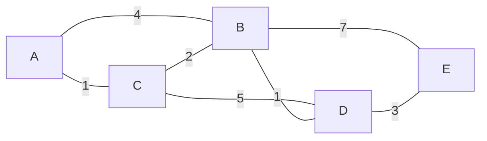

# Understanding and tracing Dijkstra

## The problem

A vertex represents a location, an edge a connection, and its weight a travel cost. Given source s, find the minimum total weight from s to every vertex. More edges can still mean a shorter route if their weights sum to less.

Dijkstra requires nonnegative weights. Zero is valid; negative weights invalidate its greedy guarantee.

## State and relaxation

- dist[v]: length of the best path found so far; it may improve before v is settled.
- settled[v]: whether v's final shortest distance is known.
- parent[v]: predecessor on the selected path.

Initially dist[s]=0, other distances=INF, and parents are empty.

Each round selects the unsettled vertex u with the smallest tentative distance and settles it. For each eligible neighbor v, compare dist[u]+weight(u,v) with dist[v]. If smaller, update dist[v] and parent[v]. This is relaxation.

Why settling is safe: if a shorter source-to-u path existed, its first unsettled vertex x would have been reached from a settled predecessor. Relaxation would give x a tentative distance no greater than that path's prefix. Nonnegative remaining weights imply dist[x]<dist[u], contradicting the selection of u.

## Example graph

Vertex IDs: A=0, B=1, C=2, D=3, E=4. Source: A. All edges are undirected.

| Edge | Weight |
| --- | ---: |
| A-B | 4 |
| A-C | 1 |
| C-B | 2 |
| C-D | 5 |
| B-D | 1 |
| B-E | 7 |
| D-E | 3 |



## Round-by-round distances

Distances below are recorded after each round's relaxations.

| Settled this round | A | B | C | D | E | Improvement |
| --- | ---: | ---: | ---: | ---: | ---: | --- |
| Initial | 0 | INF | INF | INF | INF | Source starts at 0 |
| A | 0 | 4 | 1 | INF | INF | Discover B and C |
| C | 0 | 3 | 1 | 6 | INF | B becomes 1+2; discover D |
| B | 0 | 3 | 1 | 4 | 10 | D becomes 3+1; discover E |
| D | 0 | 3 | 1 | 4 | 7 | E becomes 4+3 |
| E | 0 | 3 | 1 | 4 | 7 | No improvement |

Settlement order: A,C,B,D,E. Final distances: [0,3,1,4,7]. The route to E is A-C-B-D-E, of weight 7. Follow parents backward to reconstruct it.

B=4 after the first round is tentative, not final: going through C later improves it to 3.

## Matrix and array version

| | A | B | C | D | E |
| --- | ---: | ---: | ---: | ---: | ---: |
| A | 0 | 4 | 1 | INF | INF |
| B | 4 | 0 | 2 | 1 | 7 |
| C | 1 | 2 | 0 | 5 | INF |
| D | INF | 1 | 5 | 0 | 3 |
| E | INF | 7 | INF | 3 | 0 |

Each round scans distance-array indices to select the minimum unsettled vertex, then scans its entire matrix row. At most n rounds each perform O(n) selection and O(n) neighbor inspection, giving O(n²).

## List and heap version

```text
A: (B,4), (C,1)
B: (A,4), (C,2), (D,1), (E,7)
C: (A,1), (B,2), (D,5)
D: (B,1), (C,5), (E,3)
E: (B,7), (D,3)
```

A heap entry is (vertex, tentative distance), not an individual edge weight. Entries below are displayed in priority order for readability; a real heap array is not fully sorted.

| After processing | Remaining entries |
| --- | --- |
| Initial | A:0 |
| A | C:1, B:4 |
| C | B:3, D:6 |
| B | D:4, E:10 |
| D | E:7 |
| E | Empty |

When B improves from 4 to 3, update its existing heap key: decrease-key. position[B] locates its entry without a linear heap search. All heap swaps must update positions.

A binary min-heap requires each parent key to be no greater than its children's keys. The root is minimum; the entire array need not be sorted. With zero-based indices, parent(i)=(i-1)/2 for i>0, left(i)=2i+1, right(i)=2i+2.

Insertion appends and sifts up. Extraction replaces the root with the last entry and sifts down. Decreasing a key may sift it up. These operations take O(log n) in the worst case; inspecting the minimum alone takes O(1).

The algorithm's selections and distance updates are the same as the matrix version; data structures change how efficiently those actions happen.

## Self-check

1. Why is B=4 not final after processing A?
2. Why is C settled before B?
3. Why does D improve from 6 to 4?
4. What goes wrong if dist changes but its heap key does not?
5. Why does the matrix inspect absent-edge positions?
6. What should an isolated vertex's distance be?
7. Where does the correctness argument rely on nonnegative weights?

Trace the example yourself, implement the matrix version, then learn the heap version and its complexity.
