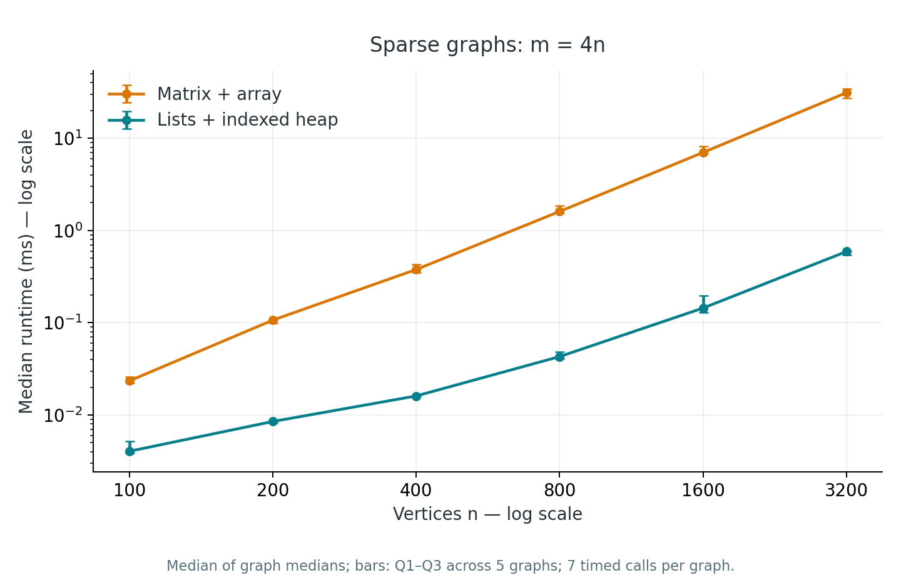
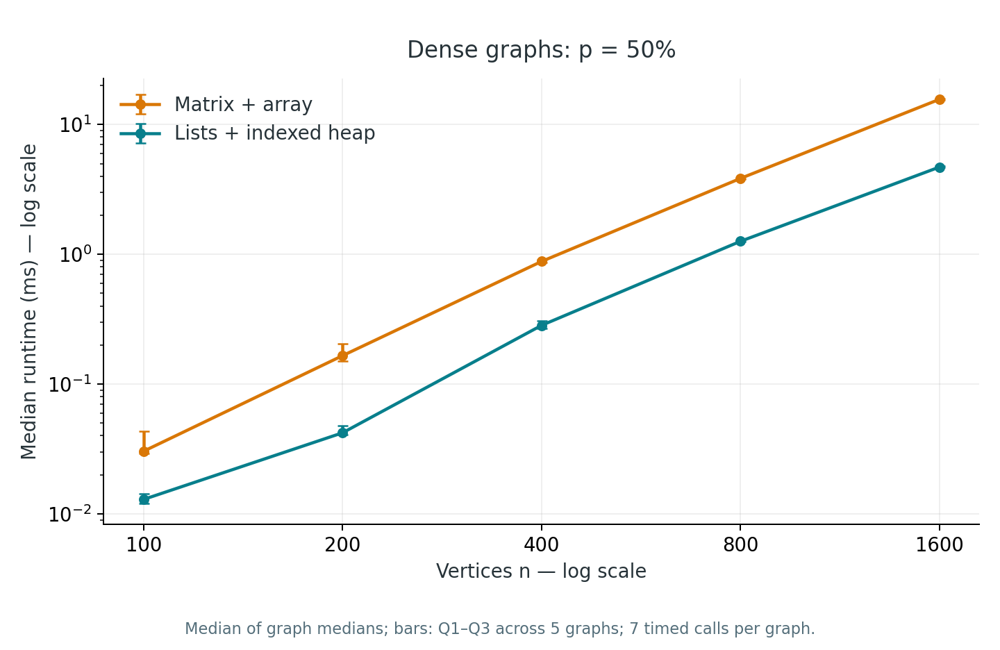
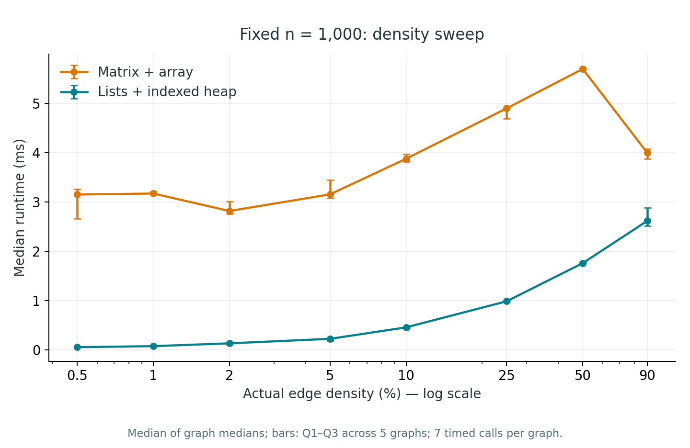
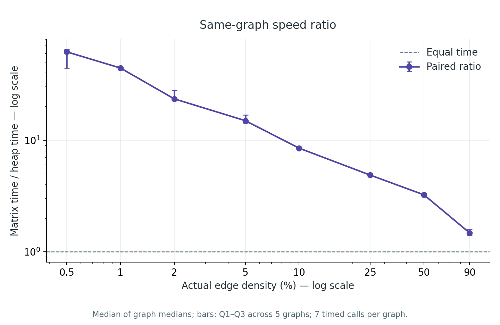
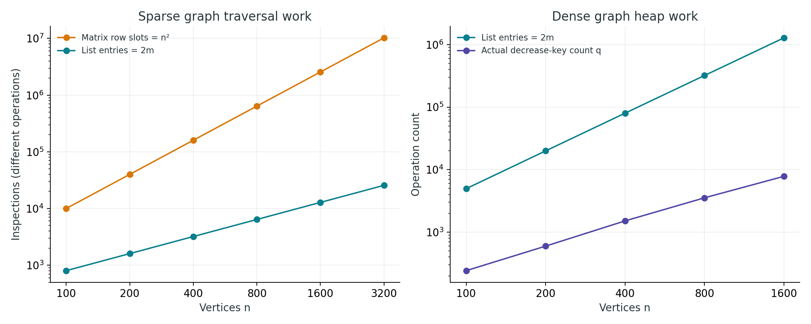

# Project 2: Dijkstra's Algorithm — Experimental Report

Run ID: **main-v1**. This report addresses the supplied one-page Project 2 specification. It presents measured results from the implemented matrix/array and list/indexed-binary-heap versions; it does not assume that one implementation wins in every possible graph family.

## 1. Problem, inputs, and implementation

Given a source vertex, Dijkstra computes shortest distances and selected predecessor paths to all vertices under nonnegative edge weights. Let n=|V| and m=|E|.

The main experiments use simple connected undirected graphs, integer weights in [1,1000], and source 0. Logical edges count once toward m; lists store 2m neighbor entries. Connectivity prevents differing unreachable components from obscuring work comparisons. Tests separately include disconnected graphs, zero weights, alternate sources, equal paths, and safe large weights.

Both algorithms consume representations converted from the same canonical edge set and return the same DijkstraResult interface. Equal priorities use smaller vertex IDs; only strict distance improvements update predecessors. They do not generate input, print, or call clocks internally.

## 2. Part (a): adjacency matrix and array

The matrix stores weights, a zero diagonal and INF for absent edges. Distances begin at INF except the source at 0. Each round linearly scans an unsorted distance/settled array to select the minimum unsettled vertex, settles it, and scans its full matrix row to relax eligible edges. Stop when no finite candidate remains.

| Work | Number of operations | Cost |
| --- | --- | --- |
| Initialize auxiliary state | One initialization | O(n) |
| Array minimum selection | Up to n full scans | O(n²) |
| Matrix-row inspection | Up to n full scans | O(n²) |
| Distance/predecessor update | O(m) improvements at most | O(m) |

Simple graphs have m=O(n²), so time is O(n²). Under complete scans on connected inputs, each scan counter equals n² and traversal has Θ(n²) work. Auxiliary space is Θ(n), while input matrix storage is Θ(n²). Few edges do not remove absent-edge inspections.

In S1 at n=3200, selection and row scans each equal 10,240,000. The aggregate matrix time median is 31.239959 ms. These counts support the quadratic-work derivation; finite timings alone do not prove a complexity bound.

## 3. Part (b): adjacency lists and indexed binary min-heap

The heap contains at most one (vertex,tentative-distance) entry per vertex. A position array locates entries in O(1); swaps update positions. Insertions/decreases sift up; extraction replaces the root and sifts down. The source is inserted first, other reachable vertices are discovered during relaxation, and every distance improvement synchronizes its heap priority.

List scans cost O(m), insertions/extractions occur at most n times each, and decrease-key occurs O(m) times at most. Binary heap operations cost O(log n). For n>=2, total time is O((n+m)log n); input plus auxiliary space is Θ(n+m), with O(n) auxiliary state alone.

If q is the actual number of decreases, a more descriptive bound is O(n+m+(n+q)log n). Most scanned edges need not improve a distance. On the dense n=1600 graph configurations, m=639600, list scans are 1,279,200 and median q is 7802 (about 1.22% of m). Thus the O(n²log n) dense worst-case bound need not be attained by these random inputs.

## 4. Experimental method

The generator version is connected-path-v1: shuffle vertices, connect consecutive vertices into a spanning path, then add distinct extra edges. Sparse requests use rejection sampling; dense requests shuffle remaining candidates. Pairs are sorted and weights assigned from a local seeded RNG. This guarantees connectivity but is not uniform sampling of all connected graphs, and graphs at different densities are not guaranteed nested.

Three suites were completed: S1 uses m=4n for six vertex sizes; S2 uses density 0.5 for five vertex sizes; S3 fixes n=1000 and varies density across eight points. Each configuration uses graph seeds 2001..2005. Both versions receive the same graph/source. Each graph/version has two warmups and seven timed calls, with recorded, independently seeded within-pair algorithm order.

There are **19 configurations, 95 graphs, 1330 timing rows and 190 separate counter rows**. The validator checks complete paired samples, parameters, graph IDs, positive finite timings, successful distance checks and counter invariants. There were no failed or omitted configurations.

steady_clock measures the algorithm call including fresh auxiliary-state initialization/allocation and result construction. Generation, conversion, pre-checking, result comparison, serialization and subsequent result destruction are outside timing. Count runs use the same reproducible inputs in separate invocations; counters are disabled during timing.

For each graph/version take the median of seven calls. For each configuration/version take the median of the five graph medians; plotted bars are Q1–Q3 across those five medians using linear type-7 quantiles. These bars are not confidence intervals. For every graph calculate R=matrix_median/heap_median, then aggregate those five ratios separately. **A paired ratio need not equal the quotient of the two aggregate time medians shown below.**

Environment: macOS-26.5.1-arm64-arm-64bit, arm64; Apple clang version 17.0.0 (clang-1700.6.3.2); reported flags `-std=c++17 -O2 -Wall -Wextra -Wpedantic`. Metadata retains actual commands, config/binary hashes, source hashes, base revision and dirty working-tree status. Configurations ran sequentially; within-pair algorithm order was randomized. CPU frequency, temperature and other background activity were not tightly controlled.

## 5. Empirical results

### S1: sparse growth, m=4n

| n | m | Actual density (%) | Matrix median (ms) | Heap median (ms) | Paired ratio |
| ---: | ---: | ---: | ---: | ---: | ---: |
| 100 | 400 | 8.081 | 0.023417 | 0.004042 | 4.73 |
| 200 | 800 | 4.020 | 0.106750 | 0.008500 | 11.68 |
| 400 | 1600 | 2.005 | 0.377834 | 0.016083 | 21.99 |
| 800 | 3200 | 1.001 | 1.610083 | 0.042958 | 37.55 |
| 1600 | 6400 | 0.500 | 7.018667 | 0.144375 | 48.61 |
| 3200 | 12800 | 0.250 | 31.239959 | 0.591667 | 57.19 |



Matrix time rises broadly with quadratic scan work. The heap version is substantially faster and the median paired advantage rises to 57.19 at n=3200. Heap timings also rise; these six finite sizes do not establish a clean n log n fit, and allocation/cache effects and timing variability can change practical constants. The exact n² versus 2m scan growth is shown in the operation-count figure; different operation types are not equivalent time units.

### S2: dense growth, p=0.5

| n | m | Actual density (%) | Matrix median (ms) | Heap median (ms) | Paired ratio |
| ---: | ---: | ---: | ---: | ---: | ---: |
| 100 | 2475 | 50.000 | 0.030375 | 0.012916 | 2.68 |
| 200 | 9950 | 50.000 | 0.165583 | 0.042125 | 3.56 |
| 400 | 39900 | 50.000 | 0.881083 | 0.283417 | 3.31 |
| 800 | 159800 | 50.000 | 3.846167 | 1.260208 | 3.05 |
| 1600 | 639600 | 50.000 | 15.650833 | 4.704917 | 3.29 |



Both implementations become more expensive as m grows quadratically. The heap version remains faster at every measured dense configuration: at n=1600, matrix and heap aggregate medians are 15.650833 and 4.704917 ms, with paired median R=3.29. This does not contradict the heap worst-case upper bound: actual q is much smaller than m, and representation/selection constants differ. We did not construct a worst-case decrease-key graph family.

### S3: fixed n=1000, varying m

| n | m | Actual density (%) | Matrix median (ms) | Heap median (ms) | Paired ratio |
| ---: | ---: | ---: | ---: | ---: | ---: |
| 1000 | 2497 | 0.500 | 3.147583 | 0.050833 | 61.92 |
| 1000 | 4995 | 1.000 | 3.167416 | 0.071167 | 44.32 |
| 1000 | 9990 | 2.000 | 2.813167 | 0.128834 | 23.48 |
| 1000 | 24975 | 5.000 | 3.150083 | 0.219875 | 14.97 |
| 1000 | 49950 | 10.000 | 3.872583 | 0.452500 | 8.49 |
| 1000 | 124875 | 25.000 | 4.895000 | 0.981916 | 4.87 |
| 1000 | 249750 | 50.000 | 5.694667 | 1.755250 | 3.24 |
| 1000 | 449550 | 90.000 | 3.992709 | 2.612750 | 1.48 |





Heap time increases with edge count, while its advantage shrinks: paired median R falls from 61.92 at approximately 0.5% density to 1.48 at 90%. At 90%, ratio Q1–Q3 is [1.42, 1.59]. All five graph medians favor heap at every density point. **No crossover was observed between approximately 0.5% and 90% density.**

Matrix minimum/row scan counters each remain 1,000,000, but runtime is not flat: existing-edge evaluation and branch outcomes change with density. The drop from 50% to 90% density is observed data, not evidence that denser matrices are universally faster. Branch predictability, cache state and execution-environment effects are plausible explanations, but hardware profiling was not performed, so no causal attribution is claimed.



## 6. Part (c): which implementation is preferable?

For the tested graph family and machine, the indexed-heap/list implementation wins in all 95 same-graph median comparisons, especially on large sparse inputs. Prefer it for similarly sparse graphs: its O(n log n) sparse bound and Θ(n+m) storage avoid quadratic absent-edge work/storage.

For dense graphs, matrix/array offers a Θ(n²) connected full-scan bound, versus the indexed binary heap's O(n²log n) worst-case upper bound. That makes it worth considering when predictable dense worst-case work, simple implementation, or compact matrix storage matters. However, **these measurements do not demonstrate a density at which our matrix implementation becomes faster**. A larger bound is not a guarantee of slower time on every actual input.

For small graphs, simple code and practical overhead may matter more than asymptotic growth. We observed a heap advantage even at n=100, but did not broadly test tiny inputs. Both representations use Θ(n²) input storage on dense graphs, with different constants. Memory was analyzed theoretically, not measured as isolated peak process memory; the benchmark simultaneously holds both representations.

Any recommendation is conditional on the actual heap design, graph/weight distribution, size and environment. Do not generalize this result to all directed graphs, adversarial inputs, alternative heaps or hardware.

## 7. Coverage of the project guide

| Guide requirement | Completed evidence |
| --- | --- |
| (a) Required implementation | src/dijkstra_matrix.cpp; hand, boundary, oracle and cross-version tests |
| (a) Theoretical n/m analysis | Section 2 and docs/theory.md |
| (a) Empirical n/m analysis | S1/S2 vertex-growth and S3 edge-count results, timings and counters |
| (b) Required implementation | src/min_heap.cpp and src/dijkstra_heap.cpp; independent tests |
| (b) Theoretical n/m analysis | Section 3, indexed-heap operation counts and docs/theory.md |
| (b) Empirical n/m analysis | Same paired S1/S2/S3 results and actual decrease counts |
| (c) Comparison and circumstances | Section 6, all paired ratios and observed absence of crossover |

The supplied one-page guide's content requirements are covered by code, theory, measurements and discussion. Submission format, presentation length, deadline and contribution requirements are not specified on that page and should follow separate course notices. This Markdown report can be adapted to that format.

## 8. Reproduction and evidence

```bash
make -j2 all test
python3 experiments/scripts/run_experiments.py --config experiments/configs/main.csv --binary build/dijkstra_benchmark --output-dir results/raw/main-reproduction
python3 experiments/scripts/summarize_results.py --run-dir results/raw/main-reproduction --output-dir results/main-reproduction
python3 experiments/scripts/plot_results.py --input-dir results/main-reproduction --output-dir figures/main-reproduction
```

Require Python 3.9+ for the standard-library runner/summary and a Python environment with Matplotlib for plots. The measured plotting version was 3.10.5. Use a fresh output directory; preserve original measurements. Generator reproduction is scoped to the recorded toolchain/version.

Versionable evidence is in [results/main-v1](../results/main-v1/summary.csv): per_graph.csv, summary.csv, paired_speedup.csv, paired_speedup_summary.csv, validation.json and environment.json. PNG/SVG charts and input hashes are in figures/main-v1. Original raw timing/count rows are retained locally in results/raw/main-v1, ignored by Git. Archive those raw files separately for reproducibility; small summaries are not a substitute for the original records.

## 9. Contributions and review

Role B's heap/list implementation was contributed by Ivan and reviewed/tested before merge. The matrix implementation, generation, shared validation, measurement pipeline and experiment tooling were completed in this workspace with AI assistance. Members should verify the explanations and adapt the contribution statement to the course's requirements rather than attributing all code to the originally planned owners.
