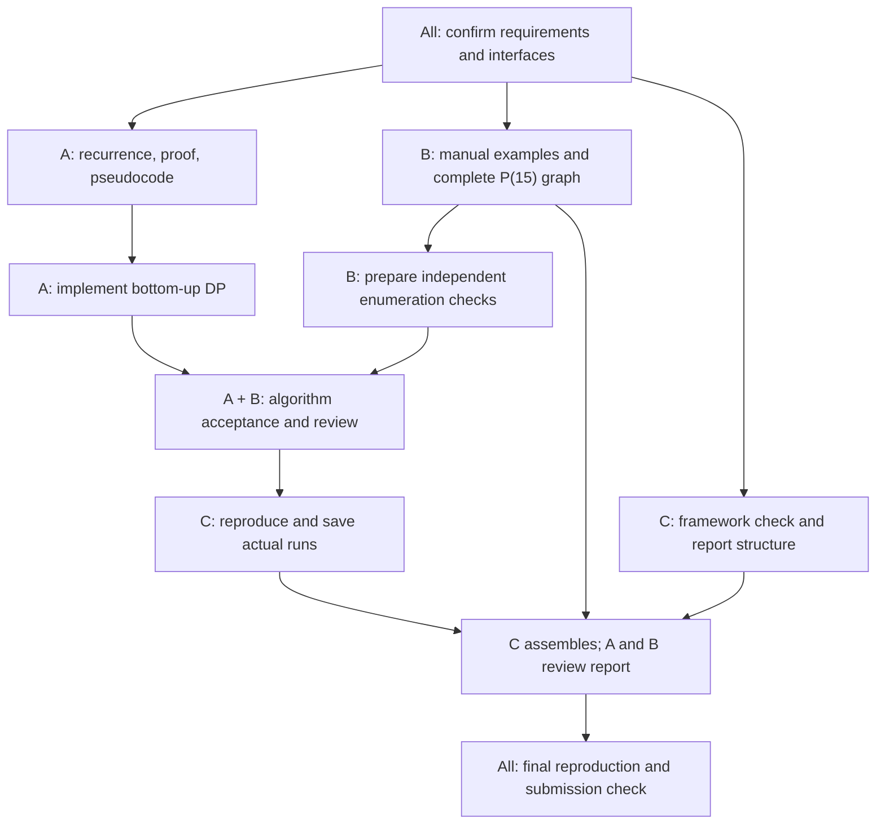

# Detailed Implementation Workflow

This plan turns the current framework into a completed Project 3 submission. It follows the agreed allocation: A leads the algorithm and theory, B leads the subproblem graph and independent validation, and C leads integration, execution evidence, and reporting. Replace A/B/C with actual member names before work starts.

The framework already provides shared types, fixed datasets, input validation, CLI handling, output formatting, the build system, and initial tests. The main remaining work is the DP implementation, a complete graph, independent validation, and the final report. Keep all project documentation and report material in English.

## 1. Overview and dependencies



Stages 2A, 2B, and 2C can proceed concurrently after the shared starting check. C saves final execution evidence after the integrated solver passes acceptance. The graph can be completed by hand before the solver is available.

## 2. Shared starting check

Owner: all members; C coordinates. Start with the same framework version.

1. Read [requirements.md](requirements.md) and identify the four assignment tasks.
2. Agree that each item type has unlimited copies, items are indivisible, and total weight may be less than C.
3. Read include/types.hpp, include/knapsack.hpp, and include/examples.hpp. Confirm that Solution.dp contains every state from 0 through C.
4. Locate the complete program flow: main.cpp -> input validation -> solve_bottom_up -> output.
5. From the repository root, enter project3-unbounded-knapsack and run:

```bash
make
make test
./build/knapsack --help
```

Deliverable: each member can build the framework and identify their assigned files. The current solver still reports PENDING; passing framework checks does not complete algorithm acceptance.

## 3. Stage 2A: A develops the algorithm and theory

Primary files: src/knapsack.cpp and docs/theory.md.

1. Define P(c) as the maximum profit at total weight at most c. State the base case and explain what happens when no item fits.
2. Explain the recurrence using one selected item and the best solution for the remaining capacity. Show that each candidate is feasible and that an optimal selection is represented.
3. Write bottom-up pseudocode: initialize the table, visit capacities in increasing order, inspect fitting items, update the best profit, and return the table.
4. Implement solve_bottom_up using the existing Problem and Solution interface. Allocate C+1 Profit entries, keep dp[0]=0, and remove the NotImplemented exception when the implementation is ready.
5. Keep input/output in the existing integration code. Compute results for arbitrary valid inputs, including the supported capacity-0 base case.
6. Explain O(nC) time and O(C) DP auxiliary space by referring to the actual loops and table. Distinguish the input storage O(n) if discussing total space.
7. Run the existing acceptance command and inspect the first failure before changing the code:

```bash
make check-solution
```

Handoff to B and C: a working solver, completed recurrence explanation, correctness reasoning, pseudocode, complexity analysis, and the acceptance status. A should be able to trace at least one state update aloud.

Completion check: the solver returns a complete table through the shared interface, and existing acceptance cases pass. B's additional independent validation is completed in Stage 3.

## 4. Stage 2B: B constructs the graph and independent checks

Primary files: docs/subproblem-graph.md and tests/test_knapsack.cpp.

1. Manually work through the two required examples. Record feasible selections, their weights, and profits. The reference maxima are 28 for P(16) in the first dataset and 16 for P(12) in the second.
2. Fill the second dataset's full table from capacity 0 through 12, so later comparison covers intermediate states as well as the final answer.
3. Expand the P(15) graph worksheet completely. From each discovered capacity c, add every legal dependency c-4, c-5, or c-8; reuse a single node for each repeated capacity.
4. Check leaves, legal edge labels, and shared dependencies. Retain all legal branches, including branches not selected by an optimal solution. All graph labels and captions must be English.
5. Review the existing test cases and explain which mistake each case would detect: missing repetition, exact-fill semantics, greedy selection, or narrow profit types.
6. Add a test-only enumeration reference in test_knapsack.cpp. Visit item types one at a time and enumerate each type's feasible count from zero through remaining_capacity/weight. Accumulate profit using Profit and retain the best complete combination.
7. Compare this reference with the DP on small inputs, such as capacities 0..20 and 1..4 item types with small positive weights and profits. Keep cases deterministic; use a fixed seed if randomizing inputs. Print the input and both answers on a mismatch.

B can prepare the graph, manual traces, and enumeration code while A implements. Execute comparisons after the solver becomes available. Register the new enumeration comparisons in the existing test main so `make check-solution` actually executes them.

Handoff to C: the completed graph and editable source, manual example explanations, the independent reference, and passing comparisons. A reviews the graph against the recurrence.

Completion check: the graph is fully expanded, and the independently computed small-case profits agree with the DP. The enumeration reference remains in tests; the required solver uses bottom-up DP.

## 5. Stage 2C: C prepares integration and reporting

Primary files: src/main.cpp, src/output.cpp, tests/test_cli.py, docs/report-outline.md, and results/.

1. Run the starting commands and understand how --case, custom input, and --table connect to the shared solver.
2. Check that the built-in datasets match the assignment: case a uses capacity 16 with weights 4/5/8; case b uses capacity 12 with weights 5/6/7; both use profits 7/6/9.
3. Use report-outline.md to prepare the final report structure. Track sections awaiting A's theory, B's graph, and actual execution output.
4. Review help text and output headings. Ensure the result flow will read the returned DP table and can display every capacity with --table.
5. Maintain a requirement-to-evidence checklist using the final mapping in Section 9. Coordinate interface changes if integration issues arise.

The initial CLI and output implementation are already provided. C's next deliverable is a prepared report structure and a clear integration checklist; solver-dependent result sections remain pending until Stage 3 passes.

## 6. Stage 3: Integrate and verify the solution

Owners: A and B; C reproduces the integrated checks.

1. Bring A's solver and B's updated tests into the same agreed project version.
2. Run framework checks and algorithm acceptance sequentially:

```bash
make
make test
make check-solution
```

3. Confirm that check-solution runs both the initial cases and B's added enumeration comparisons. PENDING or a nonzero exit means this stage is incomplete.
4. Have B trace A's update logic and A explain any failed case. C compares the returned table's shape and printed table with the interface contract.
5. If a mismatch occurs, reproduce the smallest failing input, resolve its cause, then rerun the affected checks before acceptance.

Handoff: a single integrated version with passing framework, fixed-case, and independent enumeration checks. A and B confirm that the theory and graph still agree with the implementation.

## 7. Stage 4: C generates actual execution evidence

Owner: C; B checks values and A checks their algorithmic explanation.

After Stage 3 passes, run from the project directory:

```bash
./build/knapsack --case a --table > results/case-a.txt
./build/knapsack --case b --table > results/case-b.txt
./build/knapsack --case graph --table
```

1. Confirm each command exits successfully. Open the two saved files and confirm maximum_profit=28 and maximum_profit=16 respectively, together with complete tables.
2. Compare case b's table with B's manual trace. Use the graph-case table to check values of nodes in B's P(15) graph.
3. Explain feasible optimal selections: four weight-4, profit-7 items for case a; one weight-5, profit-7 item plus one weight-7, profit-9 item for case b.
4. Describe these selections as manual explanations unless item reconstruction has actually been implemented.
5. Record the actual build/run commands, compiler version (`c++ --version`), and code revision if committed (`git rev-parse HEAD`) in the report's reproduction section. If the working tree has relevant uncommitted changes, record that status as well.

Deliverables: results/case-a.txt, results/case-b.txt, and an execution/reproduction description ready for the report. The reference answers in tests are cross-checks; the saved files must come from actual execution.

## 8. Stage 5: Assemble and review the final report

Owner: C assembles; A and B provide and review their sections.

1. Create docs/report.md using report-outline.md as the working structure, or use the course's required final format if one has been announced.
2. A supplies the state definition, recurrence, correctness reasoning, bottom-up pseudocode, and complexity analysis.
3. B supplies the complete P(15) graph, its explanation, manual selections, and independent-validation summary.
4. C supplies implementation/entry-point information, actual run outputs, reproduction instructions, and a requirement coverage check.
5. A checks that the report's pseudocode, recurrence, and complexity match the code. B checks the graph, tables, and result values. C checks English wording, labels, file references, and presentation consistency.
6. Replace report placeholders with actual content, fill in names and actual contributions, and resolve final-report TODOs. Planning worksheets may retain their original prompts, but the submitted report must be complete.

Completion check: every assignment part has an explicit answer and supporting evidence, and all three members can explain both required outputs. Apply any separately announced submission-format requirements after the content is complete.

## 9. Final deliverables and ownership

| Assignment part / supporting work | Lead | Reviewer | Completed artifact |
| --- | --- | --- | --- |
| (1) Recursive definition and explanation | A | B | Theory material and final report recurrence section |
| (2) Complete P(15) subproblem graph | B | A | Completed graph worksheet/source and final report figure |
| (3) Bottom-up algorithm | A | B | src/knapsack.cpp and final report pseudocode |
| (4a), (4b) Actual execution results | C | B; A reviews explanations | results/case-a.txt, results/case-b.txt, report result section |
| Fixed and independent correctness checks | B | A; C reruns | tests/test_knapsack.cpp and passing acceptance output |
| CLI and output integration | C | A/B | Existing integration code with any necessary fixes |
| Final English report and reproduction | C | A and B | docs/report.md or required submission-format artifact |

Before submission, one member other than A should build the integrated version and reproduce both sample outputs. Confirm the deadline, submission channel, and required format against course notices.

## 10. Each member's immediate next actions

- A: open types.hpp and knapsack.hpp, complete the recurrence explanation in theory.md, then implement solve_bottom_up in src/knapsack.cpp.
- B: open subproblem-graph.md, complete the P(15) dependencies by hand, then add the count-enumeration reference and comparisons in test_knapsack.cpp.
- C: run make/test/help, review main.cpp and output.cpp, and prepare report sections and the requirement checklist while waiting for the solver.

Progress through the stages by their completion checks. Calendar dates and work-session estimates can be assigned once the team's availability and deadline are known.
