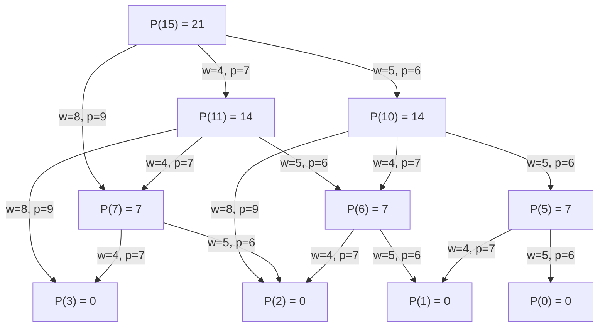

# Unbounded Knapsack: Dynamic Programming

## 1. Problem definition

Given capacity C and n item types, item i has positive integer weight w[i] and profit p[i]. Any number of copies of each type may be selected. The objective is to maximize total profit with total weight at most C; items are indivisible and capacity may remain unused. Let P(c) denote the maximum profit achievable with capacity c.

## 2. Recursive formulation (Part 1)

For c ≥ 0, define

```text
P(0) = 0
P(c) = max({0} ∪ {p[i] + P(c - w[i]) : 0 ≤ i < n and w[i] ≤ c}).
```

The zero candidate represents the empty selection, including when no item fits. Every other candidate is feasible: add one item i to a feasible selection for c − w[i]. Conversely, consider any nonempty optimal selection and remove one of its items i. Its remaining selection must be optimal for c − w[i]: otherwise replacing it with a more profitable feasible selection would improve the original solution. Thus some candidate attains the optimal profit. Positive weights make all dependencies strictly smaller than c, so the recurrence terminates.

## 3. Subproblem graph (Part 2)

For weights [4, 5, 8], profits [7, 6, 9], and capacity 15, the complete graph is below. A directed edge from P(c) to P(c − w) denotes a dependency and is labeled with the chosen item's weight and profit. Nodes are shared whenever the same capacity occurs more than once.



The leaves P(0) through P(3) are zero because no item fits. For example, P(7) is needed by both P(15) and P(11), so dynamic programming can reuse its value. The final candidates are 7 + P(11) = 21, 6 + P(10) = 20, and 9 + P(7) = 16. Therefore P(15) = 21; three weight-4 items achieve this with three units of capacity unused. The full derivation is in [subproblem-graph.md](subproblem-graph.md).

## 4. Bottom-up algorithm (Part 3)

```text
BOTTOM-UP(C, items):
    dp[0..C] ← 0
    for c ← 1 to C:
        for each (weight, profit) in items:
            if weight ≤ c:
                dp[c] ← max(dp[c], profit + dp[c − weight])
    return dp
```

Capacities are processed in ascending order, so every dependency is already computed. Because a smaller state may itself use the same item, the algorithm allows unlimited copies. By induction on c, each entry equals the recurrence in Section 2, and dp[C] is the desired result. The loops take O(nC) time and the table takes O(C) auxiliary space, apart from the O(n) input. The time bound is pseudo-polynomial in the binary input length because it depends on the numeric value of C.

## 5. Implementation and results (Part 4)

The C++17 implementation returns the entire table and uses 64-bit profit values. The following are actual outputs from the program; the complete tables are saved in the linked files.

| Case | Capacity | Weights | Profits | Observed maximum | Output |
| --- | ---: | --- | --- | ---: | --- |
| 4(a) | 16 | [4, 5, 8] | [7, 6, 9] | 28 | [case-a.txt](../results/case-a.txt) |
| 4(b) | 12 | [5, 6, 7] | [7, 6, 9] | 16 | [case-b.txt](../results/case-b.txt) |

For 4(a), four copies of the weight-4 item give profit 4 × 7 = 28. For 4(b), one weight-5 item and one weight-7 item give profit 7 + 9 = 16. These selections are manual explanations; the program reports profit and does not reconstruct items. For 4(b), dp[0..12] is [0, 0, 0, 0, 0, 7, 7, 9, 9, 9, 14, 14, 16].

## 6. Validation and reproduction

The framework and CLI checks pass. Algorithm acceptance checks cover the two required cases, P(15), zero capacity, no fitting item, repeated use with unused capacity, a greedy counterexample, equal weights with different profits, and a result exceeding 32-bit range. An independent item-count enumerator agrees with the DP for six item sets and capacities 0 through 20 (126 cases). The P(15) graph's nodes and edges were checked against the recurrence, and its node values agree with [graph.txt](../results/graph.txt).

From the `project3-unbounded-knapsack` directory:

```sh
make test
make check-solution
./build/knapsack --case a --table > results/case-a.txt
./build/knapsack --case b --table > results/case-b.txt
./build/knapsack --case graph --table > results/graph.txt
```

The recorded run used Apple clang version 17.0.0 (clang-1700.6.3.2) with the Makefile's C++17 flags. Results reflect the locally merged Member B commit `a681a1b` plus the subsequent local solver changes; the latter were uncommitted when recorded.

## 7. Contributions

The Member B branch supplied the graph, manual evaluation and independent enumeration tests. The solver and report were completed during integration. The team should confirm actual names and individual contributions before submission.
