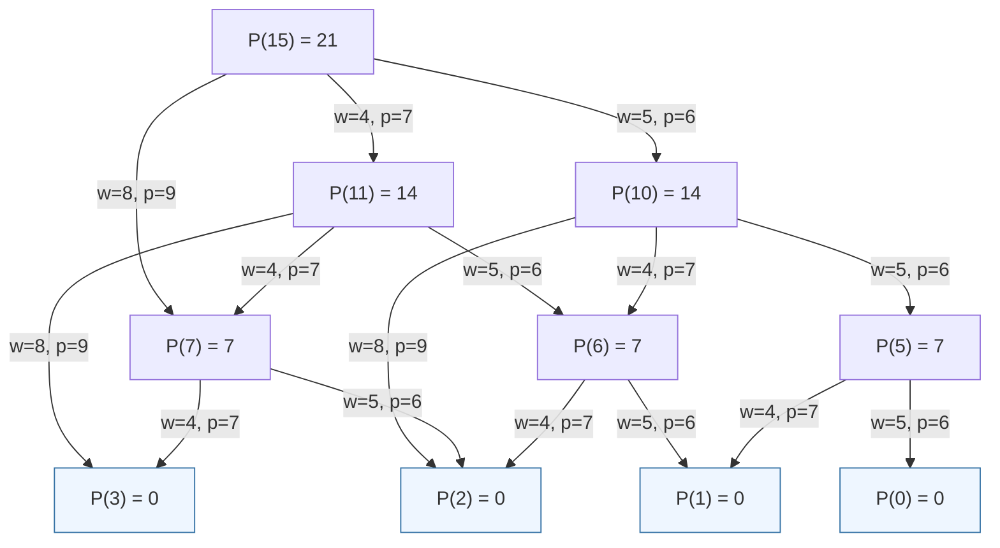

# Part (2): P(15) Subproblem Graph Worksheet

Dataset: weights=[4,5,8], profits=[7,6,9]. This is a computation dependency graph. Each node represents P(c) for one distinct capacity, and an edge points from P(c) to a required state P(c-w[i]).

## Complete dependency graph

Edge direction indicates dependency. An edge label gives the profit contributed by choosing that item. P(c) takes the maximum candidate over its legal outgoing edges; it does not sum all branches.

The reachable capacities are `15, 11, 10, 7, 6, 5, 3, 2, 1, 0`.
Capacities `0` through `3` are leaves because the lightest item weighs `4`.
Nodes such as `P(7)`, `P(6)`, and `P(2)` have multiple incoming edges. They
are computed once and reused instead of recomputing the same subproblem.

## Manual evaluation of P(15)

| State | Candidate profits | Value |
| --- | --- | ---: |
| `P(0), P(1), P(2), P(3)` | no item fits | 0 |
| `P(5)` | `7 + P(1) = 7`, `6 + P(0) = 6` | 7 |
| `P(6)` | `7 + P(2) = 7`, `6 + P(1) = 6` | 7 |
| `P(7)` | `7 + P(3) = 7`, `6 + P(2) = 6` | 7 |
| `P(10)` | `7 + P(6) = 14`, `6 + P(5) = 13`, `9 + P(2) = 9` | 14 |
| `P(11)` | `7 + P(7) = 14`, `6 + P(6) = 13`, `9 + P(3) = 9` | 14 |
| `P(15)` | `7 + P(11) = 21`, `6 + P(10) = 20`, `9 + P(7) = 16` | **21** |

The optimum uses three copies of the weight-4, profit-7 item. Their total
weight is `12`, their profit is `21`, and capacity `3` remains unused.

## Manual assignment examples

For part (4a), the same item types are used with capacity `16`. Four copies of
the weight-4 item exactly fill the capacity and give profit `4 * 7 = 28`.
The final recurrence candidates are `7 + P(12) = 28`, `6 + P(11) = 20`,
and `9 + P(8) = 23`, so `P(16) = 28`.

For part (4b), weights are `[5,6,7]` and profits are `[7,6,9]`. The complete
manual table is:

| Capacity `c` | 0 | 1 | 2 | 3 | 4 | 5 | 6 | 7 | 8 | 9 | 10 | 11 | 12 |
| ---: | ---: | ---: | ---: | ---: | ---: | ---: | ---: | ---: | ---: | ---: | ---: | ---: | ---: |
| `P(c)` | 0 | 0 | 0 | 0 | 0 | 7 | 7 | 9 | 9 | 9 | 14 | 14 | **16** |

At capacity `12`, either a weight-5 item plus the best solution for capacity
`7`, or a weight-7 item plus the best solution for capacity `5`, gives
`7 + 9 = 16`. Thus `P(12) = 16`.

## Completed review checklist

- [x] Every subproblem reachable from P(15) is included, with one node per distinct capacity.
- [x] Every edge subtracts 4, 5, or 8 and has a nonnegative destination.
- [x] Every non-leaf node includes all legal dependencies.
- [x] Capacity 0 and other leaves that cannot fit any item have value 0.
- [x] Shared subproblems have multiple incoming edges, and the graph is acyclic.
- [x] Integration review checked the graph against the recurrence and its node values against the computed DP table.

The full DP table computes every capacity from 0 through 15. The dependency
graph rooted at P(15) needs only capacities reachable from that root. The computed table from `--case graph --table` agrees with these manually derived values; see `results/graph.txt`.
