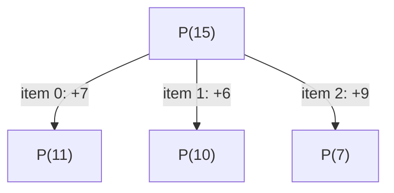

# Part (2): P(15) Subproblem Graph Worksheet

Dataset: weights=[4,5,8], profits=[7,6,9]. This is a computation dependency graph. Each node represents P(c) for one distinct capacity, and an edge points from P(c) to a required state P(c-w[i]).

## First-level illustration (incomplete; not a final answer)

Edge direction indicates dependency. An edge label gives the profit contributed by choosing that item. P(c) takes the maximum candidate over its legal outgoing edges; it does not sum all branches.

## Member B's completion steps

1. Start at 15. For each discovered capacity, subtract every weight that fits.
2. Add a node for each new capacity; reuse the existing node when a capacity has already been discovered.
3. Continue until every node has been processed. Capacities below the minimum weight have value 0 and need no edges to negative capacities.
4. Retain every legal dependency, including edges that are not part of an optimal selection. Identify shared dependencies and explain how DP reuses their results.
5. Expand the first-level Mermaid illustration into a complete graph, or replace it with a complete team-produced figure and retain its editable source.

## Review checklist

- [ ] Every subproblem reachable from P(15) is included, with one node per distinct capacity.
- [ ] Every edge subtracts 4, 5, or 8 and has a nonnegative destination.
- [ ] Every non-leaf node includes all legal dependencies.
- [ ] Capacity 0 and other leaves that cannot fit any item have value 0.
- [ ] Shared subproblems can have multiple incoming edges, and the graph is acyclic.
- [ ] A checks the graph against the recurrence; C checks node values against the completed DP table.

The full DP table computes every capacity from 0 through 15. The dependency graph rooted at P(15) needs only capacities reachable from that root. After implementation, `--case graph` can print the DP table; the team must still complete the graph.
